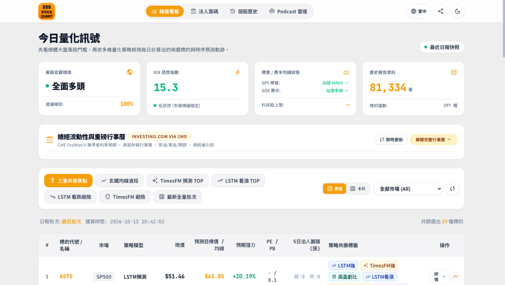
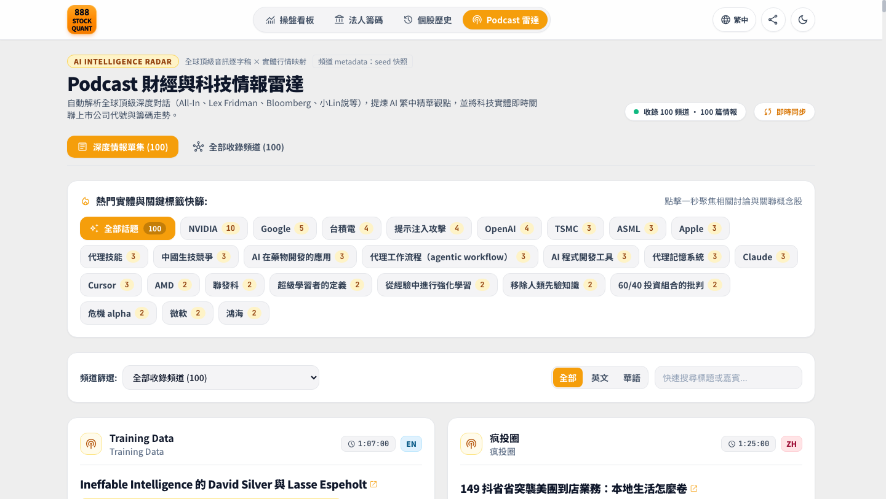
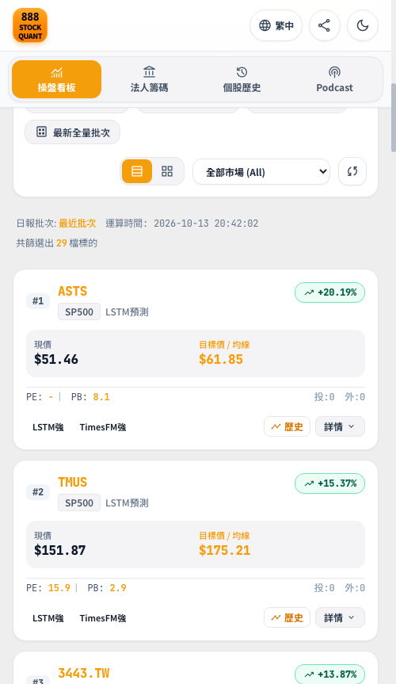
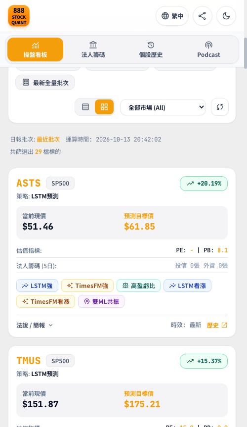
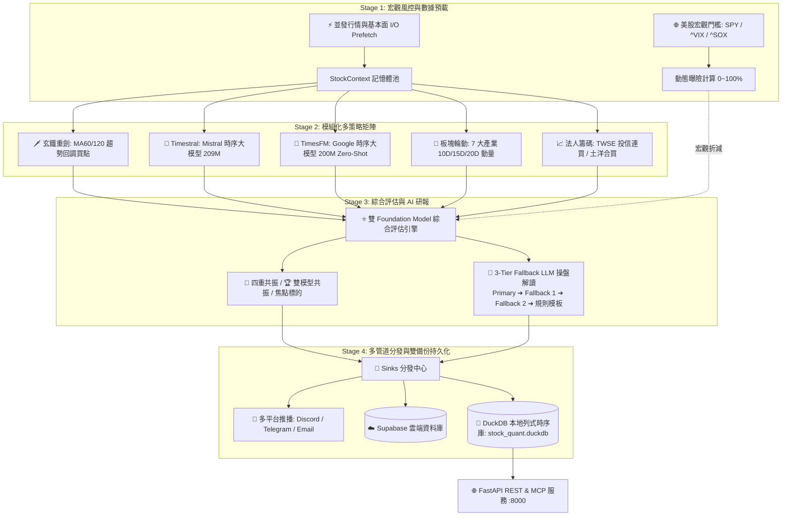

# 🚀 Stock Quantitative Multi-Strategy Platform (股票多維量化決策平台)

[](https://www.python.org/)
[](https://fastapi.tiangolo.com/)
[](https://duckdb.org/)
[](https://www.docker.com/)
[](https://hub.docker.com/r/tbdavid2019/stock-underdog-ml)
[](LICENSE)

現代化、高擴充性、生產級 **AI 深度學習與多維量化交易決策系統**。整合 **美股宏觀門檻**、**玄鐵均線技術分析**、**Mistral Timestral-209M 時序大模型**、**Google TimesFM 200M 時序大模型**、**7 大板塊資金輪動**、**台股三大法人籌碼鎖碼**、**👑 四重共振與 🏆 雙模型共振極選**、**3 級 Fallback LLM 操盤解讀**、**Clef-Flash System One 決策大模型**、**本地 DuckDB 列式時序庫**、**台灣企業集團股權網絡** 與 **20 大 FastMCP / WebMCP 工具服務**。

---

## 📸 系統介面全景展示 (Live Platform Showcase)

> 🌐 **線上即時體驗**：[https://stockdata.david888.com](https://stockdata.david888.com)  
> 專業彭博終端風格 · 深淺雙主題適配 · 桌面旗艦寬螢幕與手機端原生底部導覽列（Fixed Bottom App Bar）+ 全分頁行動卡片 RWD 零遮擋體驗

### 🖥️ 操盤看板 (Bloomberg Terminal 桌面旗艦版)
高密度量化佈局、全球宏觀大盤風控、四大共振極選矩陣與個股深度分析抽屜：


### 🎙️ Podcast 財經與科技情報雷達 (100 頂級頻道 · 100 篇實體情報流)
全量收錄全球 100 大頂級科技與宏觀財經頻道，繁中精華 TL;DR 萃取，即時關聯上市公司股票代號行情 Badge：


### 📱 行動端雙層響應式體驗 (Mobile Hybrid Quant Experience)
<p align="center">
  
  
</p>
<p align="center">
  <em>左：表格模式在手機端自動平滑轉譯為高密度量化卡片（杜絕文字擠壓折行） ｜ 右：觸控友善之單欄情報卡片視圖（Card View）</em>
</p>

---

## 🏗️ 系統架構圖 (Architecture Overview)



---

## 🎯 核心功能與策略矩陣

### 1. 🌐 宏觀風控門檻與總經日曆 (Macro Regime Gate & Investing Calendar)
* 每日預檢大盤指標：**S&P 500 (`SPY`)**、**VIX 恐慌指數 (`^VIX`)**、**費城半導體 (`^SOX`)** 與 **台灣加權 (`^TWII`)**。
* 動態識別市場情境：`全面多頭` (100% 曝險)、`多頭回調` (85% 曝險)、`避險防禦` (30~50% 曝險) 與 `極度恐慌` (0% 空倉)。
* 透過 2MD 整合 **Investing.com** 實時數據：**CME FedWatch** 聯準會降息機率、**美股重量級財報行事曆**、**關鍵大宗商品（黃金、原油、期銅）** 以及 **全球重磅總經行事曆（CPI、非農 NFP）**。
* 當費半跌破季線時，自動觸發科技股部位上限保護。
* **Polymarket 預測市場**為輔助情緒訊號：`fed_real_money_odds` 與市場 `probability` 使用 0~100 百分比；上游失敗時 API 會標記 `success=false`，若有上一筆有效快取則同時標記 `stale=true`，不把過期資料假裝成即時資料。

### 2. 🗡️ 季線支撐策略 (Trend Pullback)
* 核心思維：「**順大勢（MA60/120 多頭排列）、逆小勢（回踩均線支撐）**」。
* 精確捕捉股價回測 MA60 季線 (`MA60 Pullback`) 或 MA120 半年線之波段技術買點。

### 3. 🔮 Mistral Timestral-209M 時序大模型 (Time Series Foundation Model)
* 整合 Mistral AI 開源之 **Timestral-209M** (`mistralai/Timestral-209M`) 輕量級時序基礎模型，全面淘汰單層 LSTM 模型。
* 採用純推論 Zero-Shot 模式，輸入 128 根歷史 K 線，預測隔日 (T+1) 與未來 5 日目標價位。
* **嚴格統一對齊隔日 (T+1) 預測合約**：預測目標價 (`predicted_price`) 與潛力報酬百分比 (`potential`) 100% 嚴格對應隔日 T+1 目標價與當日收盤價之漲跌幅。
* 輸出嚴格單調的分位數區間 **P10 (下行防守位)**、**P50 (中位目標價)** 與 **P90 (上行獲利位)**，並以 T+1 分位數計算有界非對稱盈虧比（Risk-Reward Ratio）。

### 4. 🔮 Google Research TimesFM 時序大模型 (Time Series Foundation Model)
* 採用 Google 預訓練之 **TimesFM 200M** 解碼器架構時序基礎模型，以 **Zero-Shot 純推論模式** 進行全市場並發評估。
* **嚴格統一對齊隔日 (T+1) 預測合約**：預測目標價 (`predicted_price`) 與潛力報酬百分比 (`potential`) 100% 嚴格對應隔日 T+1 目標價與當日收盤價之漲跌幅。
* 同步計算隔日 **P10 (下行防守位)**、**P50 (中位預期)** 與 **P90 (上行獲利位)**，以 T+1 之 **P50 中位預期 / P10 下行防守位**計算真實盈虧比 (Risk/Reward Ratio)；P90 僅作上行參考，輸出 `TimesFM強`、`TimesFM看漲`、`高盈虧比` 標籤。
* 與 Mistral Timestral 形成 **「雙 Foundation Model 交叉驗證」**（Google TimesFM × Mistral Timestral 雙時序大模型波形共識），並晉升為 **「綜合優選」**。

### 5. 🌊 7 大產業板塊資金輪動 (Sector Rotation Strategy)
* 即時追蹤台股與美股 7 大核心板塊：`半導體與IC設計`、`AI伺服器與電子科技`、`金融保險`、`重電與綠能基建`、`航運與原物料`、`傳統產業與化學`、`生技醫療與太空概念`。
* 計算各板塊 10D (40%) + 15D (30%) + 20D (30%) 加權動量資金流，挑選當日前 3 大主流強勢板塊。

### 6. 📈 台灣三大法人籌碼分析 (TWSE Institutional Flow)
* 直連 **臺灣證券交易所 (TWSE T86 / MI_QFIIS)** 與 **櫃買中心 (TPEX)** 官方開放數據。
* 自動統計 5日/20日 外資與投信累計買賣超（張數），識別 **「投信連買 >= 3 天」** 與 **「土洋合買」** 主力鎖碼個股。

### 7. ⭐ 綜合優選 / 雙模型看漲評估 (Dual Foundation Model Consensus)
* 跨維度篩選同時符合 **「季線支撐買點 ∩ TimesFM 看漲 ∩ Timestral 看漲 ∩ 投信/外資主力大買」** 之最高信心標的。
* 自動貼上 `綜合優選`、`雙模型看漲`、`土洋合買`、`投信連買`、`高盈虧比`、`主流板塊`、`低PE` 等量化標籤。
* 目標價以 TimesFM 與 Timestral P50 進行等權防禦性合成（$0.5 \times P_{TimesFM} + 0.5 \times P_{Timestral}$），單一模型缺漏時自動優雅退化降級。
* **個股歷史查詢 (Ticker Explorer)**：
  - **T+1 目標兌現日平移折線圖**：第 $i$ 天之隔日預測平移至 $i+1$ 與次日真實收盤對照，杜絕「影子線」錯覺，右側設有 `'隔日預估 (T+1)'` 錨點。
  - **K 線級高互動縮放平移與時間區間快選 (v2.4.46)**：支援滑鼠滾輪縮放、按住拖曳平移、手機雙指縮放與雙擊重置；內建 `近1月 (22D)`、`近2月 (45D)`、`近1季 (66D)`、`半年 (130D)`、`全部 (ALL)` 區間快選，搭配視窗動態 Y 軸自動貼合（Auto-fit）與開獎標點尺度自適應。
  - **雙模型準確率 PK 成績單**：統計歷史已開獎日之「隔日方向勝率」、「平均價格絕對誤差 (MAPE)」與「雙模型同場 PK 勝場」；嚴格遵循 50% 方向勝率門檻防禦機制（雙模型勝率皆 < 50% 不授獎，並警示改看均線支撐與籌碼）。
  - **每日一列對決表**：按日整合收盤價、隔日真實收盤、雙模型預測誤差與當日勝出模型，未開獎標記 `⏳ 待下個交易日開獎`。

### 8. 🧠 3 級 Fallback AI 研報引擎與多渠道日報推播 (AI Narrative & Multi-Channel Daily Digest)
* 支援 **Primary ➔ Fallback 1 ➔ Fallback 2 ➔ 純程式規則模板** 4 級容錯。
* 採用標準 OpenAI 相容協定，支援 Google Gemini 2.5 Flash、DeepSeek-V3、OpenAI GPT-4o-mini 或自建 Gateway。
* 無 API Key 時自動平滑降級為確定性規則模板，確保推播與日報 100% 不中斷。
* **多渠道日報推播 (Telegram / Discord / Email)**：全面對齊隔日 (T+1) 目標價流程（`現價 → 目標價`）、P10/P90 風控區間與盈虧比，並將波段操作全面正名為「季線支撐」，提供兼具宏觀風控、AI 操盤總評與綜合優選的專業金融排版。

### 9. 🦆 本地 DuckDB 列式時序庫與多層級快取架構 (Multi-Tier Caching & Persistence)
* 本地採用高性能嵌入式列式資料庫 **DuckDB**（`data/storage/stock_quant.duckdb`），已納入 44,000+ 筆歷史時序記錄（壓縮後僅 4.1 MB）。
* **全棧零冗餘多層級快取架構 (L1 Memory -> L2 DuckDB -> L3 Disk -> Upstream)**：
  - **AI 決策推論持久化 (`decision_verdicts`)**：當使用者點擊個股詳情或透過 API/MCP 調用 AI 評定時，推論結果自動持久化至 DuckDB，同日再次查詢毫秒級（<2ms）直接命中；支援 `force_refresh` 強制重新推論。
  - **企業基本面估值 (`company_fundamentals`)**：PE、Forward PE、PB、EV/EBITDA 等指標自動存儲於 DuckDB，提供 24h 效期與跨進程共享，大幅減少對 yfinance 的對外網路請求。
  - **法說會查詢前置防禦 (`earnings_calls`)**：個股法說會查詢優先命中本地 DuckDB 快取，避免重複對 BigGo API 發送外部請求。
  - **股票名稱/代碼高頻解析器 LRU 快取 (`_RESOLVER_CACHE`)**：內建 2,000 筆、24h TTL 之記憶體快取，消除重複對日 K 與三大法人表的大表掃描，解析延遲降至 0.005ms（提升 5,000 倍）。
  - **高頻 API 響應記憶體快取**：大盤統計 (`/market/stats`, 60s)、券商買賣超 (`/market/broker/*`, 180s)、策略預測榜單 (`/predictions/*`, 30s) 自動快取，抵禦併發流量。
* 支援零延遲 Pandas 查詢、一鍵導出 `.parquet` 冷備份，並提供一鍵資料庫全量同步工具：
  ```bash
  python scripts/export_supabase_to_duckdb.py
  ```

### 10. ⚡ 5 級階梯式韌性決策大模型與跨使用者持久化 (5-Tier Resilient Decision Engine & DuckDB Caching)
* 整合 Cloudflare Clef-Flash、JEV 與 OpenAI 決策模型，實施 **5 級高可用 Fallback 架構**：
  - **Tier 1 (主力)**: `https://clef.create360.ai/v1/systemone` (Clef-Flash System One 快思考推理)
  - **Tier 2 (備援 1)**: `https://clef.aiurl.tw/v1/systemone` (llama.cpp GGUF 節點)
  - **Tier 3 (備援 2)**: `https://api.typesafe.ai/v1/systemone` (JEV 原生端點)
  - **Tier 4 (備援 3)**: OpenAI 結構化決策模型 (JSON Schema 降級)
  - **Tier 5 (兜底保障)**: **100% 確定性本地啟發式規則引擎 (Local Rule Heuristics Fallback)**。
* **🚨 永不崩潰鐵律保證**：若所有遠端決策模型（Tier 1~4）全數遭遇斷線、503 服務不可用或逾時，系統自動於 2ms 內無縫降級至本地確定性啟發式規則，確保決策推論 100% 正常可用，API 恆常返回 HTTP 200。
* **⚡ 跨使用者 DuckDB 二級快取**：同一標的當日已推論之動作分佈（`strong_buy`, `buy`, `hold_watch`, `avoid`）與確信度評分直接自 DuckDB 毫秒級讀取，避免多使用者或重複點擊反覆向上游發送相同推論請求。
* 提供 REST 端點 `POST /api/v1/decision/evaluate`（支援 `force_refresh` 參數）、`GET /api/v1/decision/health` 與原生 FastMCP / WebMCP 工具 `get_clef_stock_verdict`。

### 11. 🎙️ Podcast 財經與科技情報雷達 (Financial & Tech Podcast Radar)
* 匯聚國際頂級深度訪談與總經科技頻道（All-In, Lex Fridman, Bloomberg Businessweek, Odd Lots, Dwarkesh, The Diary of a CEO, 硅谷101, 瘋投圈, 小Lin說 等 **100 大主流頻道**），即時收錄全球深度對話。
* **結構化深度提煉**：即時解析單集主題、主持人 (Host)、特別嘉賓 (Guest) 與 150~200 字繁中核心 TL;DR 觀點。
* **⚡ 市場催化重要性評級與標的多空推論**：透過 5 級決策鏈推論市場催化強度（⭐ 重磅 / ⚡ 重要 / 📰 關注）以及上市公司股票的多空姿態（`↑ 看多`、`↓ 看空`、`↔ 持平`），並提供專屬快篩開關。
* **💾 DuckDB 全量持久化與 0ms SWR 水合**：所有收錄頻道、單集情報與決策重要性評級全量持久化於本地 DuckDB，前端支援 Stale-While-Revalidate (SWR) 本地端即時水合，開啟網頁瞬間 0ms 秒級呈現，杜絕重複請求與等待延遲。
* **科技實體至上市公司 Ticker 聯結**：自動識別單集談及的科技實體（Claude, OpenAI, NVIDIA, Google, TSMC, ASML 等），無縫映射至上市股票代號（`NVDA`, `2330.TW`, `MSFT`, `GOOGL`），點擊 Badge 即可秒級開展個股時序與三大法人籌碼抽屜。
* **熱門實體快篩軌**：頂部提供橫向滑動熱門關鍵字（Top Entities Rail），點擊即可一秒過濾相關標的對話。

### 12. 🔭 AI 產業鏈前沿挖掘機 (AI Tech Radar & Discovery Engine)
* **左側前瞻題材捕捉**：突破單純右側技術跟隨與籌碼追蹤，定時主動爬取學術界 arXiv 前沿論文（`cs.AI`, `cs.RO`, `cs.LG`, `cs.CV`），由技術突破點直接映射至關鍵硬體瓶頸。
* **5 大前沿技術瓶頸與台美供應鏈映射**：
  - **CPO 光互連與矽光子**：美股錨點 `NVDA`, `AVGO`, `COHR`；台灣供應鏈台積電 `2330`、智邦 `2345`、光聖 `6442`、聯鈞 `3450` 等。
  - **HBM / KV-cache 記憶體牆**：美股錨點 `NVDA`, `MU`, `AMD`；台灣供應鏈聯發科 `2454`、信驊 `5274`、創意 `3443` 等。
  - **液冷散熱與熱管理**：美股錨點 `VRT`, `SMCI`；台灣供應鏈奇鋐 `3017`、雙鴻 `3324`、建準 `2421` 等。
  - **具身智能機器人**：美股錨點 `TSLA`, `NVDA`；台灣供應鏈所羅門 `2359`、上銀 `2049`、台灣精銳 `4583` 等。
  - **先進封裝 CoWoS**：美股錨點 `NVDA`, `TSM`；台灣供應鏈台積電 `2330`、弘塑 `3131`、辛耘 `3583` 等。
* **代號正規化與 Universe 白名單硬過濾**：自動正規化台股代碼（去 `.TW`/`.TWO` 後綴）與美股大寫，嚴格與股票池白名單交集，杜絕虛構下市標的。
* **確定性 7 維多因子評分核心**：固化權重公式 $\text{Total} = \text{clamp}(0.20 S_{src} + 0.20 S_{purity} + 0.20 S_{paper} + 0.10 S_{novelty} + 0.10 S_{sent} + 0.10 S_{setup} - 0.10 S_{risk}, 0, 100)$，嚴格分流至 `propose_add`、`observe`、`already_in_pool` 與 `reject`。
* **雙層原子持久化與連線分離**：DuckDB 交易成功 commit 後，以 `tempfile + os.replace` 原子替換靜態 JSON 快照；FastAPI 查詢端強制使用 `read_only=True`，杜絕連線衝突。
* **4/2/1 彭博終端情報矩陣**：前端整合 KPI 摘要卡、原生 Inline SVG 趨勢迷你圖、個股研究卡（Dossier）lazy-render 展開與手機底部橫向滾動適配。

### 13. 🕸️ 跨市場 AI 產業價值鏈與供應鏈傳導圖譜 (Cross-Market AI Value Chain & Supply Graph)
* **官方權威分類與 SEC 10-K 大客戶披露結合**：串接櫃買中心與證交所「產業價值鏈資訊平台 (`ic.tpex.org.tw`)」，結合美國 SEC EDGAR 10-K 年報中主要客戶法定文字披露（>10% 營收依賴），打造零 Key、免付費、權威度高之台美產業動態圖譜。
* **8 大前沿主題與三欄階層畫布（上游 ➔ 中游 ➔ 下游）**：
  - 涵蓋 `全部主題`、`HBM/儲存`、`CPO/光互聯`、`電力/液冷`、`先進封裝`、`AI晶片/算力`、`伺服器/ODM` 與 `機器人/具身智能`。
  - 採用前端動態 SVG 三次貝茲曲線 (`M x1 y1 C cx1 cy1, cx2 cy2, x2 y2`) 連結上中下游，視覺化呈現零組件供應、雲端 CapEx 驅動、大客戶依賴與戰略生態關聯。
* **即時量化預測與法人籌碼動態注入**：
  - 每個產業鏈節點在查詢時由 DuckDB 時序引擎即時融合：最新收盤價、今日真實漲跌幅、Mistral Timestral-209M 與 Google TimesFM 隔日目標價預測，以及三大法人/投信連買天數標籤。
* **流暢互動導航**：點擊任一標的卡片即時高亮其上下游關聯供應鏈網絡（無關節點淡化），支援滾輪縮放、平移、隱藏未連線節點與一鍵直達個股技術 K 線歷史。
* **📘 完整架構、趨勢演進與維護手冊 (SOP)**：
  - 詳細說明未來時代趨勢演進時的「80/20 核心與前沿分流哲學」、3 大前瞻感知訊號（arXiv 論文突破、巨頭法說會 Capex 詞彙共振、SEC 10-K 大客戶披露），以及**新增主題、調整上中下游節點、從前沿挖掘機升格標的、下架過期主題之完整 SOP**。
  - 詳情請參閱：[`docs/INDUSTRY_VALUE_CHAIN_GUIDE.md`](docs/INDUSTRY_VALUE_CHAIN_GUIDE.md)。

### 14. 📱 行動端 RWD 雙層響應式架構 (Adaptive Mobile Hybrid Architecture)
* **智慧裝置自適應**：手機直向螢幕（`< 768px`）自動預設為單欄式高密度情報卡片（`Card View`），觸控人體工學友善，手動切換狀態自動同步至 `localStorage`。
* **表格模式 RWD 混合轉譯 (Hybrid Table-to-Card)**：當使用者在手機上選擇表格模式時，自動轉譯為**「高密度行動量化卡片」**，保留 # 排名、代號、現價、目標價、PE/PB、法人籌碼與抽屜展開，文字絕不垂直擠壓折行。
* **桌面彭博寬表格**：平板與桌面端（`>= 768px`）提供專業級寬表格，賦予 `min-w-[980px]` 與所有欄位 `whitespace-nowrap`，保障橫向滑動體驗流暢穩固。

### 14. ⏰ 盤前買進決策排程與純股市數據庫 (Pre-Market Schedule & Raw Data Warehouse)
本系統核心定位為**「開盤前的進場買進指南（Pre-Market Buy Guide）」**，所有計算與數據抓取均嚴格在市場開盤前完成，並透過 `--market auto` 實施智慧時段防護（白天專注台股、夜間專注美股，非手動指定全市場時杜絕資源浪費）：

* **🇹🇼 台股開盤前指南 (每日 08:00 執行 / UTC 00:00，時段 05:00~13:30 派發)**：
  - 於台股 08:30 試撮與 09:00 開盤前完成運算與推播。
  - 自動同步前一交易日台股全市場收盤行情、三大法人盤後結算籌碼以及昨夜美股收盤連動。
  - 夜間時段嚴格停止台股運算，避免重複消耗 CPU 與記憶體資源。
* **🇯🇵 日股開盤前指南 (每日 07:15 執行 / 台北時間，東京 08:15 盤前)**：
  - 於東證 TSE 09:00 (東京時間 / 台北 08:00) 開盤前 45 分鐘產出日經 225 (Nikkei 225) 雙時序大模型預測與日股宏觀曝險。
* **🇺🇸 美股開盤前指南 (每日 20:30 執行 / UTC 12:30，時段 13:30~05:00 派發)**：
  - 於美股 21:30 (夏令) / 22:30 (冬令) 開盤前 1 小時產出 S&P 500 多維量化決策與 Google TimesFM 預測。
  - SP500 分析集合保留太空主題擴充標的：`SPCX`、`DXYZ`、`ASTS`、`RKLB`；這些標的屬於策略擴充，不代表目前正式 S&P 500 成分資格。
  - 白天時段嚴格停止美股重複運算。
* **🔧 yfinance 自動巡檢 (每日 07:30 執行 / UTC 23:30)**：
  - 於台股盤前排程前自動檢測 PyPI 最新版本並驗證 API 相容性。

**📥 自動抓取與持久化之「純股市數據（Raw Market Data）」：**

| 純數據資料表 / 路徑 | 數據來源 | 欄位與內容 | 用途與優勢 |
| :--- | :--- | :--- | :--- |
| **`tw_daily_bars`**<br>(DuckDB) | TWSE & TPEX<br>官方 OpenAPI | • 開高低收 (OHLC)<br>• 成交量 (Volume)<br>• 成交金額 (Trade Value)<br>• 漲跌幅與交易筆數 | 1~2 秒內全量同步上市櫃 1,800+ 檔純行情，提供限流備援 |
| **`tw_institutional_daily`**<br>(DuckDB) | 證交所 T86<br>官方結算表 | • 外資買/賣/淨買超<br>• 投信買/賣/淨買超<br>• 自營商買/賣/淨買超<br>• 三大法人合計淨買超 | 累積 510,000+ 筆歷史純籌碼，支援投信連買與土洋合買分析 |
| **`tw_broker_trades`**<br>(DuckDB) | 券商分點進出明細 | • 分點代號與名稱<br>• 買進張數 / 賣出張數<br>• 累計買賣超與佔比 | 追蹤高盛、大摩、富邦、元大等主力分點連續加減倉水庫曲線 |
| **`macro_regimes`**<br>(DuckDB) | 全球宏觀指數 | • S&P 500 (`SPY`)<br>• VIX 恐慌指數 (`^VIX`)<br>• 費城半導體 (`^SOX`)<br>• MA60 季線水位與建議曝險 | 判定全球系統性風險，自動啟動科技股倉位上限風控 |
| **`data/cache/`**<br>(Parquet / Pickle) | 標的成分股序列 | • 台灣50 (`TW0050`)<br>• 台灣中型100 (`TW0051`)<br>• 台股活躍精選 (`TW_ACTIVE` 850)<br>• S&P 500 (`SP500` 500+)<br>完整 6 個月 OHLCV 日 K 線 | 本地零延遲時序快取，加速特徵工程與策略回測 |

**🌍 全球證券清冊與最後成功快照：**

清冊與日 K 分離保存。`market_universe` 是跨市場主檔，支援 `TW`、`US`、`HK` 及未來新增的 `JP`、`CN`、`GB`、`EU` 等市場；每個官方來源使用獨立 provider、獨立 cache 與獨立同步狀態。

| 官方來源 | Provider / Cache | 標準化內容 |
| :--- | :--- | :--- |
| TWSE + TPEx | `TwseTpexProvider` / `cache/universe/TW.json` | 上市、上櫃代號、名稱、交易所、Yahoo 標準代號；成功時同步 `tw_daily_bars` |
| NASDAQ / NYSE / AMEX / ARCA / BATS / IEX | `NasdaqTraderProvider` / `cache/universe/US-NASDAQ-TRADER.json` | NASDAQ Trader `nasdaqlisted.txt`、`otherlisted.txt`，保留交易所、Market Category、Financial Status、Round Lot |
| HKEX | `HkexProvider` / `cache/universe/HK-HKEX.json` | 股票代號、官方提供的名稱、ISIN、Board Lot、證券類別 |
| JPX / TSE | `JpxProvider` / `cache/universe/JP-JPX.json` | 4 位代號、英文名稱、Prime/Standard/Growth/ETF 等產品分類 |
| SSE | `SseProvider` / `cache/universe/CN-SSE.json` | A 股、B 股、科創板代號、中文/英文名稱、上市板別 |
| SZSE | `SzseProvider` / `cache/universe/CN-SZSE.json` | A 股、B 股代號、中文/英文名稱、主板/創業板分類 |
| Euronext | `EuronextProvider` / `cache/universe/EU-EURONEXT.json` | 官方 `stocks-all-places` 完整 CSV；各交易地點 MIC、代號、名稱、ISIN |
| LSE | `LseProvider` / `cache/universe/GB-LSE.json` | SETS、SETSqx、EQS 官方證券清單、Mnemonic、ISIN、證券類別 |

每次全球同步會依序更新上述七個非台灣官方來源；TWSE/TPEx 則由台股同步入口一起更新。每個來源只有在資料完整、欄位有效且筆數通過檢查後才會替換自己的 cache。上游逾時、空資料、格式錯誤或單一來源失敗時，系統只對該來源保留最後成功快照，API 以 `stale=true`、`snapshot_date`、`cache_age_days` 與 `error` 明確標示，不把舊資料偽裝成最新資料。查詢端點：`GET /api/v1/market/universe?source_id=TW`。

官方來源參考：[Nasdaq Trader Symbol Directory](https://www.nasdaqtrader.com/Trader.aspx?id=SymbolDirDefs)、[HKEX Securities Lists](https://www.hkex.com.hk/Services/Trading/Securities/Securities-Lists?sc_lang=en)、[JPX TSE-listed Issues](https://www.jpx.co.jp/english/markets/statistics-equities/misc/01.html)、[Euronext Stocks Directory](https://live.euronext.com/en/products/equities/list)、[LSE UK and European Securities](https://www.londonstockexchange.com/equities-trading/asset-classes/shares-trading/uk-and-european-securities)。

### 15. 📅 跨市場交易行事曆與開休市守衛 (Market Trading Calendar & Holiday Guard Engine)
* **🇹🇼 台股 TWSE OpenAPI 直連與 3 層防禦**：直連臺灣證券交易所官方 OpenAPI (`https://openapi.twse.com.tw/v1/holidaySchedule/holidaySchedule`)，支援本機 30 天磁碟快取 (`data/cache/market_calendar/twse_holidays_{year}.json`) 與記憶體快取；精確解析民國年 (`1150101` -> `2026-01-01`) 與「最後交易/開始交易/市場無交易/放假補假」語意分類；內嵌 2024~2027 年台股重要休市與封關交割日離線備援資料庫。
* **🇺🇸 美股 NYSE/NASDAQ 10 大法定假日與復活節演算法**：以 Meeus/Jones/Butcher 匿名公曆演算法精確計算復活節好禮拜五 (Good Friday)；支援六月節 (Juneteenth)；嚴格遵循美股官方放假補假規則 (Observation Rule：週六提前至週五、週日延後至週一、跨年元旦週六於 12/31 提前休市)。
* **🛡️ 全市場同步與三大法人籌碼排假守衛**：
  - 全市場日 K 同步腳本 (`scripts/sync_twse_market.py`) 自動偵測休市並跳過（支援 `--force` 強制執行），避免假日對證交所空轉請求。
  - 三大法人籌碼模組 (`data/institutional.py`) 整合交易日回溯，嚴格排除週末與國定假日（如中秋、國慶、春節封關交割日），並維持 15:30 盤後出表截止時間門檻。
* **🌐 REST API 行事曆查詢端點**：
  - `GET /api/v1/market/calendar/status`：查詢指定市場、代號或特定日期之交易日狀態、休市原因及前後交易日 (T+1 / T-1)。
  - `GET /api/v1/market/calendar/holidays`：查詢指定市場與年份之全年度休市清冊與假日說明。

---

## 🌐 互動式操盤首頁、FastAPI REST 與 MCP 服務

本平台內建現代化 FastAPI 高效能對外服務（預設連接埠 `8088`），同時提供「人類操盤視覺化儀表板」、「Anthropic Claude Desktop MCP 工具伺服器」以及「AI Agent Skill」：

### 1. 📊 現代化量化操盤首頁 (Web Dashboard - Figma 外觀拉皮 v.1)
啟動後直接瀏覽 `http://localhost:8088/` 或線上站點 [https://stockdata.david888.com](https://stockdata.david888.com)：
* **彭博終端視覺與雙主題切換**：全面升級曜石黑 (`#030302`)、深黑卡片 (`#0D0E11`)、琥珀金 (`#F59E0B`) 與淺色灰白雙主題，頂部提供膠囊藥丸 Tab（`Tab / Large`）與狀態文字切換開關（`顯示: 深色模式` / `顯示: 淺色模式`）。
* **高密度量化訊號表 (Signal Table)**：支援高密度表格與情報卡片雙重視圖，具備等寬金融數字（JetBrains Mono `tabular-nums`）、彩色策略/法人 Badge 系統、外部門戶跳轉（Yahoo 股市 / Goodinfo），以及點擊即時展開之公司簡介抽屜 (Company Drawer)。
* **宏觀風控與總經日曆**：在上游資料可用時掌握 VIX 恐慌指數、S&P 500、費城半導體均線狀態、建議曝險比例、CME FedWatch 降息監控、美股重量級財報日曆與 Polymarket 預測市場；資料缺失時 API 明確回傳不可用狀態。
* **法人籌碼與券商主力雷達**：三大法人淨買賣超排行 TOP 30 表格、TOP 8 目標券商多折線走勢圖（霓虹色系、深淺色自適應網格）與 TOP 15 主力買超/賣超分點雙欄比較清單。
* **個股歷史時序查詢**：輸入代號或名稱（如 `2330.TW`、`NVDA`、`台積電`、`聯發科`），即時檢索歷次量化預測目標價、均線買點、三大法人累計折線圖與逐日籌碼數據。
* **前端原生模組化架構**：樣板解耦為 Jinja2 partials，腳本抽取為原生 ES 模組（`api-client.js`, `chart-manager.js`, `app.js`），維持免 Node.js build step 輕量極速特性。
* **Agent & MCP 中心**：提供一鍵複製 Claude Desktop、Cursor 與 Python 串接代碼及 llms.txt 標準規格。

### 2. 🤖 Model Context Protocol (MCP) 原生工具伺服器
提供符合 Anthropic 官方標準的 FastMCP 伺服器（[`mcp_server.py`](file:///Users/david/git/tbdavid2019/stock-underdog-ml/mcp_server.py)），可直接掛載至 Claude Desktop、Cursor、Antigravity：

**Claude Desktop 設定 (`claude_desktop_config.json`)：**
```json
{
  "mcpServers": {
    "stock-quant": {
      "command": "python",
      "args": [
        "/home/david/stock-underdog-ml/mcp_server.py"
      ]
    }
  }
}
```

**支援之 20 大標準量化 MCP 函數 (FastMCP & WebMCP 原生工具)：**

1. `get_market_macro_regime`: 總經風控與建議曝險比例 (0~100%)。
2. `get_triple_resonance_stocks`: 查詢 👑四重共振、🏆雙模型共振焦點多策略交集個股。
3. `get_xuantie_pullback_stocks`: 玄鐵重劍 MA60/120 波段回踩買點標的。
4. `get_timestral_top_predictions`: Mistral Timestral 209M 5 日預測漲跌榜、分位數區間 (P10/P90) 與盈虧比。
5. `get_timesfm_top_predictions`: Google Research TimesFM 200M 5 日預測漲跌榜與真實盈虧比 (Risk/Reward)。
6. `get_lstm_top_predictions`: (已棄用別名，自動映射至 Timestral 模型)。
7. `get_stock_history`: 個股時序預測軌跡與法人籌碼。
8. `get_latest_market_snapshot`: 最新全市場日報批次數據快照。
9. `get_top_institutional_flows`: 三大法人（外資、投信、自營商）買賣超焦點股排行榜。
10. `get_broker_trades_for_stock`: 關鍵券商主力分點進出明細與累計買賣超。
11. `get_company_profile`: 2MD 繁中公司營運簡介、董監事持股、即時新聞與集團網絡連結。
12. `get_fed_rate_monitor`: CME FedWatch 利率決策機率與 FOMC 倒數。
13. `get_us_earnings_calendar`: 美股重量級企業財報公布行事曆（EPS、營收預估）。
14. `get_economic_calendar`: 全球重大總經行事曆（CPI、非農 NFP 等）。
15. `get_commodities_summary`: 關鍵大宗商品（黃金 Gold、銅 Copper、原油 WTI）實時行情。
16. `resolve_stock_ticker`: 中英文公司名稱模糊搜尋與代號解析（如台積電 ➔ `2330.TW`）。
17. `get_polymarket_macro_sentiment`: Polymarket 真金白銀預測市場宏觀情緒（聯準會降息機率、美股牛熊、科技AI突破、地緣政治衰退機率）。
18. `get_clef_stock_verdict`: 透過 Clef-Flash System One 決策大模型（3 級 Fallback：create360 / aiurl.tw / jev）推論交易動作機率分佈、確信度評分與勝率預期。
19. `get_upcoming_earnings_calls`: 查詢台美日韓跨市場即將召開之法人說明會時程、雙時區與官方簡報/影音回放。
20. `get_ticker_earnings_calls`: 查詢單一標的之歷史法說會紀錄、管理層財測指引（營收/毛利率/CapEx）與機構 Q&A。
21. `get_company_network`: 查詢台灣上市櫃公司之集團股權結構與企業關係網絡（母公司/控股、轉投資子公司持股比例與上市櫃標的關聯）。
22. `open_company_network`: 在瀏覽器中導航開啟特定台股企業之視覺化股權拓撲關係圖譜與官方 SVG 向量架構 (Taiwan Company Network)。
23. `get_company_tenders`: 查詢台灣上市櫃公司之政府電子採購網得標情報（累計得標總金額、勝率、獨標率、核心採購機關金主、競標對手與大案清單，串接 ToBid MCP）。

### 3. 📖 Agent Skill 規範檔 (`SKILL.md`)
本專案已建立標準 Agent 技能規範檔 [`skills/stock-quant/SKILL.md`](file:///Users/david/git/tbdavid2019/stock-underdog-ml/skills/stock-quant/SKILL.md)，亦可直接透過 API 獲取：`http://localhost:8088/skill`。
> 💡 **動態最新拉取提示**：平台機能快速演進，建議外部 AI Agent（Claude, Cursor, Antigravity）在執行任務前隨時重新發送 HTTP GET 請求至 `/skill`、`/llms.txt` 或 `/.well-known/mcp.json`，取得即時更新之 MCP 函數契約與資料字典。

### 4. 核心 REST API 端點清單

| 端點 | 方法 | 說明 |
| :--- | :---: | :--- |
| `/` | `GET` | 互動式操盤儀表板與 Agent 整合中心 (HTML) |
| `/llms.txt` | `GET` | 符合 [llmstxt.org](https://llmstxt.org/) 規範之 AI Agent / LLM 系統摘要與端點導引 |
| `/llms-full.txt` | `GET` | 完整開發者與大模型參考手冊 (含數學公式、DuckDB Schema、MCP 工具定義) |
| `/.well-known/mcp.json` | `GET` | WebMCP 遠端發現規格清單 (23 大量化工具宣告) |
| `/mcp/sse` | `GET` | WebMCP SSE (Server-Sent Events) 雙向遠端串流通訊端點 |
| `/.well-known/ai-plugin.json` | `GET` | WebMCP / OpenAI Plugin 標準宣告檔 |
| `/skill` | `GET` | 取得 Agent Skill 規範檔 (Markdown) |
| `/health` | `GET` | 系統健康狀態與 DuckDB 總記錄筆數 |
| `/api/v1/decision/evaluate` | `POST` | Clef-Flash System One 決策模型評估端點 |
| `/api/v1/decision/health` | `GET` | Clef 3 級決策端點健康度檢查 (create360 / aiurl.tw / jev) |
| `/api/v1/predictions/latest` | `GET` | 查詢多指數最新各標的現價、預測價、均線數據、PE/PB 估值與籌碼 |
| `/api/v1/predictions/resonance` | `GET` | 篩選 **👑四重共振 / 🏆雙模型共振** 重點焦點股 |
| `/api/v1/predictions/xuantie` | `GET` | 篩選 **玄鐵重劍技術買點**（回測 MA60 季線 / MA120 半年線） |
| `/api/v1/predictions/timestral/top-bullish` | `GET` | 查詢 **Mistral Timestral 預測漲幅 TOP N** 看漲榜與盈虧比 |
| `/api/v1/predictions/timestral/top-bearish` | `GET` | 查詢 **Mistral Timestral 預測跌幅 TOP N** 避險/破底防禦榜 |
| `/api/v1/predictions/timesfm/top-bullish` | `GET` | 查詢 **Google TimesFM 預測漲幅 TOP N** 看漲榜與盈虧比 |
| `/api/v1/predictions/timesfm/top-bearish` | `GET` | 查詢 **Google TimesFM 預測跌幅 TOP N** 避險/破底防禦榜 |
| `/api/v1/predictions/lstm/*` | `GET` | 已棄用之向後相容別名端點（自動轉譯並回傳 `X-Deprecation-Warning`） |
| `/api/v1/predictions/history/{ticker}` | `GET` | 查詢單一標的（如 `2330.TW`、`AAPL`）之時間序列歷史軌跡 |
| `/api/v1/predictions/resolve/{query}` | `GET` | 將股票代號、英文/中文公司名稱解析為標準代號 |
| `/api/v1/macro/latest` | `GET` | 即時取得台美股大盤宏觀風控狀態、建議曝險、FedWatch 降息機率與總經催化劑 |
| `/api/v1/macro/investing/summary` | `GET` | Investing.com 一站式總經數據（FedWatch、美股財報、大宗商品、行事曆） |
| `/api/v1/macro/polymarket/sentiment` | `GET` | Polymarket 真金白銀宏觀預測市場情緒（含降息預期與各類大事件機率） |
| `/api/v1/macro/investing/fed-rate` | `GET` | CME FedWatch 聯準會降息機率分布表與 FOMC 倒數 |
| `/api/v1/macro/investing/earnings-calendar` | `GET` | 美股重量級企業財報行事曆（EPS、營收預估、市值規模） |
| `/api/v1/macro/investing/commodities` | `GET` | 關鍵大宗商品（黃金、銅博士、WTI 原油）即時行情與週期漲跌 |
| `/api/v1/macro/investing/economic-calendar` | `GET` | 全球重大總經行事曆（CPI、非農 NFP 等） |
| `/api/v1/market/institutional/top` | `GET` | 三大法人買賣超焦點排行 |
| `/api/v1/market/universe` | `GET` | 全球證券清冊、來源 snapshot 與 stale/cache freshness 狀態 |
| `/api/v1/market/company-profile/{ticker}` | `GET` | 查詢公司中文營運簡介、董監事持股、即時新聞與集團網絡連結（支援 DuckDB 20天快取與跨使用者共享） |
| `/api/v1/market/company-network/{ticker}` | `GET` | 查詢台股標的之登記統一編號、資本額、母公司控股、轉投資子公司與集團股權網絡（支援 DuckDB 30天快取） |
| `/api/v1/market/company-tender/{ticker}` | `GET` | 查詢台股標的之政府採購得標金額、勝率、獨標率、採購機關與對手標案情資（串接 ToBid MCP，支援 DuckDB 7天快取） |
| `/api/v1/market/broker/summary/{ticker}` | `GET` | 券商主力分點累計買賣超統計 |
| `/api/v1/stats/summary` | `GET` | DuckDB 時序庫全盤統計（總記錄數、涵蓋股票數、時間跨度） |
| `/api/v1/earnings-call/upcoming` | `GET` | 查詢台美日韓跨市場法人說明會、雙時區（CST/EST）、時間維度篩選（ALL/TODAY/UPCOMING/PAST）與天數倒數 |
| `/api/v1/earnings-call/{ticker}` | `GET` | 查詢單一標的之法說會歷程、官方簡報 PDF 與影音回放網址 |
| `/api/v1/earnings-call/calendar` | `GET` | 取得月度法說會日曆聚合場次、權值股場次計數與逐日結構化場次清單 |
| `/api/v1/earnings-call/sync` | `POST` | 觸發非同步背景跨市場法說會資料全量同步 |
| `/api/v1/podcast/episodes` | `GET` | 查詢 Podcast 單集情報、繁中 TL;DR 與關聯股票量化資料快照；快照不等同即時行情 |
| `/api/v1/podcast/channels` | `GET` | 取得收錄之國際頂級科技與總經 Podcast 頻道庫列表；metadata 來源標記為 `seed_snapshot` |
| `/api/v1/podcast/topics` | `GET` | 取得熱門科技實體與話題標籤頻次聚合排行榜 |
| `/api/v1/podcast/sync` | `POST` | 觸發非同步背景 Podcast 最新 RSS 抓取與單集 raw metadata 同步 |
| `/api/v1/discovery/candidates` | `GET` | 查詢前沿技術瓶頸映射至台美股供應鏈之候選標的清單與 7 維多因子評分拆解 |
| `/api/v1/discovery/papers` | `GET` | 查詢 arXiv 前沿突破論文（cs.AI / RO / LG / CV）、架構瓶頸標籤與關聯標的 |
| `/api/v1/discovery/signals` | `GET` | 查詢前沿訊號事件流與情緒指標 |
| `/api/v1/discovery/history` | `GET` | 查詢前沿雷達候選數量、論文數量與評分時序趨勢 |
| `/api/v1/discovery/status` | `GET` | 取得 Discovery 管線健康度、快照基準日與 Stale 降級標記 |
| `/api/v1/industry-chain/themes` | `GET` | 取得 AI 產業價值鏈主題清單與上中下游成分股數量統計 |
| `/api/v1/industry-chain/graph` | `GET` | 查詢跨市場產業價值鏈三欄拓撲結構，動態注入現價、漲跌幅、時序大模型目標價與法人連買籌碼 |

---

## 🚀 快速開始 (Quick Start)

### 1. 環境配置

複製環境變數範本並填入必要設定：

```bash
cp .env.example .env
```

**關鍵配置項 (`.env`)：**
```bash
# 雲端 Supabase 資料庫 (必填)
SUPABASE_URL=https://your-project.supabase.co
SUPABASE_SERVICE_KEY=your_service_role_key

# 本地 DuckDB 路徑 (預設: data/storage/stock_quant.duckdb)
ENABLE_DUCKDB=true
DUCKDB_PATH=data/storage/stock_quant.duckdb

# 3-Tier Fallback LLM 操盤解讀配置 (選填，無 Key 則使用純規則模板)
LLM_PRIMARY_BASE_URL=https://generativelanguage.googleapis.com/v1beta/openai/
LLM_PRIMARY_MODEL=gemini-2.5-flash
LLM_PRIMARY_API_KEY=your_gemini_key

LLM_FALLBACK1_BASE_URL=https://api.deepseek.com/v1
LLM_FALLBACK1_MODEL=deepseek-chat
LLM_FALLBACK1_API_KEY=your_deepseek_key

# 推播通知 (選填)
DISCORD_WEBHOOK_URL=https://discord.com/api/webhooks/...
TELEGRAM_BOT_TOKEN=your_bot_token
TELEGRAM_CHAT_ID=your_chat_id
```

---

### 2. 執行方式 A：本機 Python 原生模式（推薦開發與除錯）

```bash
# 建立並啟用虛擬環境
python3.12 -m venv venv
source venv/bin/activate

# 安裝依賴
pip install -r requirements.txt

# 1. 執行開盤前多維量化分析指南
python main.py                     # 智慧判定 (預設 auto: 白天 05:00~13:30 跑台股；夜間 13:30~05:00 跑美股)
python main.py --market tw         # 🇹🇼 台股開盤前指南 (08:00 執行，涵蓋 台灣50 + 台灣中型100 + 台股活躍精選，共 1,000 檔標的)
python main.py --market us         # 🇺🇸 美股開盤前指南 (20:30 執行，S&P 500 全量 503 檔 + 太空/AI 前沿純度股，共 510+ 檔)
python main.py --index 台股1000    # 🇹🇼 單一巨集執行台股 1,000 檔流動性活躍預測池
python main.py --market all        # 🌐 全市場手動指定 (台股 1,000 檔 + 美股 500+ 檔)
python main.py --dry-run           # 乾跑模式 (不寫入 DB 且不發送推播)

# 2. 啟動 FastAPI REST 服務 (Port 8088)
python api/main.py

# 3. 執行全套單元測試
python -m unittest discover -s test -p 'test_*.py'

# 4. 從 Supabase 全量導出歷史資料至 DuckDB
python scripts/export_supabase_to_duckdb.py
```

---

### 3. 執行方式 B：Docker 容器化模式（推薦無人值守生產部署）

本專案提供預先構建完成之 **Docker Hub 官方多架構映像檔**，支援 **`linux/amd64` (Intel/AMD x64)** 與 **`linux/arm64` (Apple Silicon M系列 / ARM 伺服器)** 雙架構。

> 💡 **為什麼強烈推薦使用預建映像檔？**
> 本專案整合 PyTorch、TensorFlow、DuckDB 等大型科學計算與深度學習依賴庫，若在本地自行從原始碼構建 (`docker build`) 通常需耗時 10~20 分鐘以上，且極易因本機記憶體不足或編譯工具差異中斷。
> 官方 GitHub Actions CI/CD 會在每次更新時自動完成雙架構優化編譯與全量單元測試，發布至 Docker Hub，**直接 `docker pull` 數十秒內即可完成部署！**

#### 🌟 0. 新機器全自動一鍵安裝 (One-Click Setup on New Machine)
```bash
# Clone 專案後執行一鍵安裝腳本，自動完成依賴檢測、目錄初始化、.env 配置、API 服務與定時排程啟動與健康驗證：
git clone https://github.com/tbdavid2019/stock-underdog-ml.git
cd stock-underdog-ml
bash scripts/install_new_machine.sh
```

#### 🐳 A. 直接拉取 Docker Hub 官方映像檔
```bash
# 1. 直接拉取 Docker Hub 最新多架構映像檔 (強烈推薦，免本地編譯)
docker pull tbdavid2019/stock-underdog-ml:latest

# (備援鏡像) 或使用 GitHub Container Registry (GHCR)
docker pull ghcr.io/tbdavid2019/stock-underdog-ml:latest
```

#### 🚀 B. 使用 Docker Compose 一鍵啟動 (推薦)
```bash
# 1. 一鍵拉取 Docker Hub 預建映像檔 (免本地 Build)
docker compose pull

# 2. 啟動 FastAPI REST & Web UI 服務 (常駐背景: http://localhost:8088)
docker compose up -d stock-ml-api

# 3. 啟動 24H 定時排程容器 (依台北時間台股盤前 08:00 與美股盤前 20:30 自動產出買進指南)
docker compose up -d stock-ml-cron

# 4. 手動單次執行指定市場盤前指南
docker compose run --rm stock-ml python main.py --market auto  # 依時段智慧派發台股或美股 (預設)
docker compose run --rm stock-ml python main.py --market tw    # 🇹🇼 強制執行台股
docker compose run --rm stock-ml python main.py --market us    # 🇺🇸 強制執行美股

# 5. 容器內執行 Supabase ➔ DuckDB 資料同步
docker compose run --rm stock-ml-sync

# 6. 容器內執行全套單元測試
docker compose run --rm stock-ml-test
```

#### ⚡ C. 單行命令直接啟動（無需 Clone 原始碼專案）
```bash
docker run -d \
  -p 8088:8088 \
  --name stock-ml-api \
  --restart unless-stopped \
  -v $(pwd)/data/storage:/app/data/storage \
  -v $(pwd)/logs:/app/logs \
  tbdavid2019/stock-underdog-ml:latest
```

---

## 📂 專案目錄結構 (Project Structure)

```text
stock-underdog-ml/
├── api/                        # FastAPI REST & MCP 服務模組
│   ├── routes/                 # predictions, macro, stats 路由
│   ├── schemas.py              # Pydantic v2 資料結構
│   └── main.py                 # FastAPI 入口與 CORS/Swagger 配置
├── core/                       # 核心基礎設施
│   ├── config.py               # 集中式環境配置 (LLM, 板塊, DB)
│   └── device.py               # CUDA / MPS / CPU 硬體管理
├── data/                       # 資料獲取與時序儲存
│   ├── cache.py                # 指數與行情快取管理器
│   ├── duckdb_manager.py       # DuckDB 本地列式時序資料庫
│   ├── fetcher.py              # 行情與 Answerbook 榜單抓取
│   ├── fundamentals.py         # PE/PB/EV/EBITDA 基本面抓取
│   ├── institutional.py        # TWSE/TPEX 三大法人籌碼分析器
│   └── macro.py                # 美股宏觀風控分析器 (SPY/VIX/SOX)
├── models/                     # 機器學習與時序大模型封裝
│   ├── timestral_model.py      # Mistral Timestral-209M 時序大模型 (Zero-Shot P10/P50/P90)
│   ├── timesfm_model.py        # Google TimesFM 200M 預訓練模型載入與分位數風險評估
│   └── lstm.py                 # (已棄用) 舊版單層 LSTM 架構向後相容 Stub
├── strategies/                 # 插件式量化策略註冊中心
│   ├── base.py                 # BaseStrategy 抽象基底類別
│   ├── registry.py             # 策略自動發現與註冊中心
│   ├── xuantie.py              # 玄鐵重劍均線趨勢回調策略
│   ├── timestral.py            # Mistral Timestral 209M 5 日時序預測策略
│   ├── timesfm.py              # Google TimesFM 時序大模型預測策略 (P10/50/90 盈虧比)
│   ├── lstm.py                 # (已棄用) LSTM 策略相容 Stub
│   ├── sector_rotation.py      # 7 大板塊資金輪動策略
│   └── institutional.py        # 三大法人連買與土洋合買策略
├── evaluators/                 # 綜合評價與研報引擎
│   ├── composite_evaluator.py  # 多策略動態評分與四重/三重共振標籤
│   ├── ai_narrative.py         # 3 級 Fallback LLM 操盤解讀引擎
│   └── formatter.py            # 美化終端機與推播日報排版工具
├── pipeline/                   # 分層管線排程器
│   └── orchestrator.py         # 4-Stage 量化管線執行調度器
├── docker/                     # 容器化腳本與排程
│   ├── entrypoint.sh           # 多模式啟動入口 (預設安全導向 api)
│   └── crontab                 # 台北時區定時排程定義
├── scripts/                    # 遷移與維護腳本
│   ├── export_supabase_to_duckdb.py # Supabase ➔ DuckDB 全量遷移工具
│   └── sync_twse_market.py     # TWSE / TPEX 官方 OpenAPI 全市場日 K 棒批量同步
├── test/                       # 自動化測試套件 (104 項全量單元測試)
├── Dockerfile                  # 生產級 Python 3.12 Slim 映像 (CMD api)
├── docker-compose.yml          # 多服務 Docker 堆疊定義 (Hugging Face 權重快取掛載)
└── main.py                     # CLI 主程序入口 (--market auto 智慧時段判定)
```

---

## 🌐 線上服務與 WebMCP / Agent 入口 (Live Endpoints)

* **🖥️ 即時操盤儀表板**: [https://stockdata.david888.com](https://stockdata.david888.com)
* **🤖 WebMCP SSE 串流**: `https://stockdata.david888.com/mcp/sse`
* **📑 WebMCP Manifest**: `https://stockdata.david888.com/.well-known/mcp.json` & `/mcp.json`
* **📄 LLM Context 協議**: `https://stockdata.david888.com/llms.txt` & `/llms-full.txt`
* **🌉 Cloudflare WebMCP Bridge**: `https://stockdata.david888.com/.webmcp/bridge.js`
* **📘 Swagger API 文件**: `https://stockdata.david888.com/docs`

首頁也提供標準 SEO 與社群分享資源：`/favicon.svg`、`/favicon-32x32.png`、`/apple-touch-icon.png`、`/og-image.png` 與 `/site.webmanifest`。

---

## 🤖 GitHub Actions 自動化 CI/CD

本專案配置了完整 GitHub Actions 自動化流程（`.github/workflows/docker-ci-cd.yml`）：
1. **🧪 測試關卡 (Test Gate)**：每次 Push / PR 自動執行全量單元測試。
2. **🐳 多架構構建**：測試通過後自動構建 `linux/amd64` (Intel/AMD) 與 `linux/arm64` (Apple Silicon / ARM) 雙架構映像。
3. **📦 自動推送**：發布至 GitHub Container Registry (`ghcr.io/tbdavid2019/stock-underdog-ml`) 與 Docker Hub。

### 🔐 自動更新與主線保護

- `yfinance` 排程檢查只會建立 dependency update PR，通過一般 PR CI 後再合併，不直接推送 `main`，也不使用 `[skip ci]` 繞過驗證。
- 建議在 GitHub `main` 分支設定 branch protection：要求 CI/CD workflow 通過、啟用 force-push/delete 保護；個人專案仍可由專案擁有者自行合併 PR。
- 直接推送 `main` 會觸發測試與 Docker pipeline，但不會產生 PR，因此不會有 PR Agent 的 inline review 留言。

---

## 📜 開發規範與文件同步

遵循本專案開發鐵律（`AGENTS.md`）：
- 每次功能或行為變更均同步記錄於 [`CHANGELOG.md`](CHANGELOG.md)。
- Docker 詳細指南請參閱 [`docs/DOCKER.md`](docs/DOCKER.md)。
- 跨市場產業價值鏈架構與維護指南請參閱 [`docs/INDUSTRY_VALUE_CHAIN_GUIDE.md`](docs/INDUSTRY_VALUE_CHAIN_GUIDE.md)。
- OpenSpec 變更與規格請參閱 [`openspec/specs/`](openspec/specs/)。

---

## 📄 授權條款 (License)

本專案採用 [GNU AGPL-3.0 License](LICENSE) 授權。
