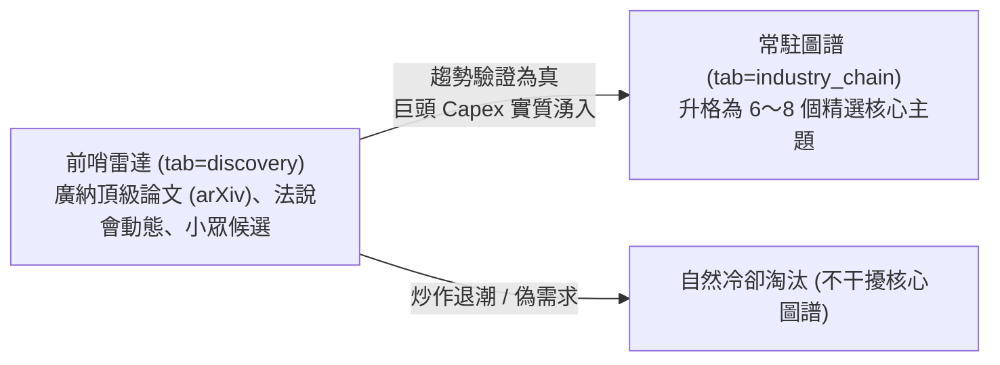

# 跨市場 AI 產業價值鏈與供應鏈圖譜架構及維護指南 (Industry Value Chain & Graph Guide)

> 本文件說明 `stock-underdog-ml` 系統中「跨市場 AI 產業價值鏈與供應鏈傳導圖譜」（`tab=industry_chain`）的設計哲學、資料架構、前瞻趨勢感知機制，以及未來當產業演進時**新增、修改、升格或汰換研究主題的完整操作 SOP**。

---

## 目錄
1. [架構設計理念與 80/20 法則](#1-架構設計理念與-8020-法則)
2. [系統資料流與資料庫結構](#2-系統資料流與資料庫結構)
3. [未來趨勢感知機制：如何知道何時該調整主題？](#3-未來趨勢感知機制如何知道何時該調整主題)
4. [主題與節點維護 SOP (Step-by-Step)](#4-主題與節點維護-sop-step-by-step)
   - [SOP 1：新增全新產業研究主題](#sop-1新增全新產業研究主題)
   - [SOP 2：為現有主題補充/調整節點或供應鏈關係](#sop-2為現有主題補充調整節點或供應鏈關係)
   - [SOP 3：從「前沿挖掘機 (tab=discovery)」升格標的](#sop-3從前沿挖掘機-tabdiscovery-升格標的)
   - [SOP 4：下架或合併退潮冷門主題](#sop-4下架或合併退潮冷門主題)
5. [常見問答 (FAQ)](#5-常見問答-faq)

---

## 1. 架構設計理念與 80/20 法則

### 核心哲學：少即是多（Less is More），聚焦資本開支（Capex）
資本市場的殘酷現實是：**只有全球科技巨頭與主權基金每年數百億美元資本開支（Capex）集中灌注的領域，才能持續走出倍數級的強勢主線行情**。
若系統盲目「包羅萬象」收納傳統水泥、塑化、紡織、食品、金融等 50+ 個產業鏈，不僅會引發前端連線的**「雜訊災難（Noise Overload）」**，更會稀釋投資者寶貴的注意力。

因此，本系統採用 **【80 / 20 動態升格架構】**：


* **80% 常駐圖譜 (`tab=industry_chain`)**：嚴格維持在 **6～8 個最核心技術瓶頸主題**，每一檔標的都具備高純度與真實營收傳導。
* **20% 前哨沙盒 (`tab=discovery`)**：充當前瞻試驗場，捕捉萌芽期的論文突破與潛在供應鏈，驗證成熟後才「升格」至常駐圖譜。

---

## 2. 系統資料流與資料庫結構

### 跨市場資料流架構
```
[外部公開數據源]
  ├─ 台灣櫃買中心官方產業鏈 (ic.tpex.org.tw) ──> HTML 解析 / 14天快取
  ├─ 美國 SEC EDGAR 10-K Major Customers ──> 大客戶 (>10% 營收) 披露
  └─ 高保真離線備援庫 (EMBEDDED_NODES) ──> 離線/無網降級保證
                       │
                       ▼
            [DuckDB 時序與圖譜資料庫]
  ├─ tw_industry_chains    (主題與產業鏈定義)
  ├─ tw_industry_nodes     (上/中/下游股票角色與所屬主題)
  ├─ tw_industry_relations (實體關聯邊：供應鏈/資本開支/大客戶)
                       │
                       ▼ 批次注入即時指標
  ├─ 最新日 K 收盤價與真實漲跌幅 (tw_daily_bars)
  ├─ Timestral-209M / TimesFM 雙時序大模型目標價 (predictions)
  └─ 三大法人/投信連買天數與買超張數 (tw_institutional_daily)
                       │
                       ▼
[FastAPI REST API: /api/v1/industry-chain/themes & /graph]
                       │
                       ▼
[前端三欄階層畫布: 上游 ➔ 中游 ➔ 下游 + 動態 SVG 貝茲連線]
```

### DuckDB 資料表結構
1. **`tw_industry_chains`**：主題定義
   - `chain_id` (VARCHAR PK): 主題識別碼，如 `HBM_STORAGE`、`CPO_OPTICAL`
   - `name` (VARCHAR): 中文主題名稱，如 `HBM/儲存`
   - `name_en` (VARCHAR): 英文主題名稱
   - `category` (VARCHAR): 領域類別（預設 `AI`）
   - `description` (VARCHAR): 主題瓶頸與產業說明
   - `updated_at` (VARCHAR): 更新時間戳記
2. **`tw_industry_nodes`**：股票節點
   - `ticker` (VARCHAR): 股票代號（台股如 `2330`，美股如 `NVDA`）
   - `company` (VARCHAR): 公司簡稱
   - `market` (VARCHAR): `TW` 或 `US`
   - `chain_id` (VARCHAR): 主要歸屬主題 ID
   - `layer` (VARCHAR): 產業鏈層級：`upstream` (上游), `midstream` (中游), `downstream` (下游)
   - `role` (VARCHAR): 產業核心角色定位
   - `key_focus` (VARCHAR): 關鍵產品或技術重點
   - `theme_tags` (VARCHAR JSON): 標籤陣列，支援一檔股票跨多個主題（如 `["POWER_COOLING", "SERVER_ODM"]`）
3. **`tw_industry_relations`**：傳導關聯邊
   - `source_ticker` (VARCHAR): 來源代號（供應商/組裝廠）
   - `target_ticker` (VARCHAR): 目標代號（客戶/雲端大廠）
   - `relation_type` (VARCHAR): `產業鏈` (藍實線), `資本開支` (綠虛線), `大客戶依賴` (橘點線), `主題關聯` (紫虛線)
   - `description` (VARCHAR): 連線具體業務說明
   - `weight` (DOUBLE): 關聯強度權重 (0.1 ~ 1.0)

---

## 3. 未來趨勢感知機制：如何知道何時該調整主題？

科技演進的本質是**「物理瓶頸的轉移（Bottleneck Shift）」**：
* 算力不夠 ➔ 搶 GPU 晶片
* 記憶體跟不上 ➔ 搶 HBM 與先進封裝
* 功耗發熱爆表 ➔ 搶液冷水冷板與電網
* 銅線延遲過大 ➔ 搶 CPO 矽光子
* 數位模型飽和 ➔ 走向物理世界機器人與邊緣端運算

當未來時代趨勢轉變時，透過以下 **3 個前瞻訊號** 即可清楚判定何時該調整主題：

| 訊號類型 | 觀察來源 | 預警提前期 | 觸發調整門檻 |
| :--- | :--- | :--- | :--- |
| **1. 學術論文爆發** | `tab=discovery` arXiv 雷達 | 前瞻 6～12 個月 | 頂級架構論文中，某未定義新詞彙（如 `Neuromorphic`、`Quantum Computing`、`SRAM Cache`）單月出現頻率激增 >300%。 |
| **2. 巨頭法說會術語共振** | 科技巨頭 Earnings Call 逐字稿 | 前瞻 1～3 個月 | NVDA、AMD、MSFT、GOOG 兩家以上在法說會中同步將該領域列為次年 Capex 重點支出項目。 |
| **3. 供應鏈大客戶揭露** | 美股 SEC 10-K / 台灣公開資訊觀測站 | 當前季度確認 | 巨頭年報 Major Customers 或台廠重大訊息公告出現大規模新採購合約。 |

---

## 4. 主題與節點維護 SOP (Step-by-Step)

本系統採 **「前端完全自動化」** 設計。前端的主題膠囊按鈕、上中下游計數與連線渲染全部是向後端 `/api/v1/industry-chain/themes` 與 `/graph` 動態索取，因此**維護時完全不需要修改任何前端 HTML/JS 程式碼**！

### SOP 1：新增全新產業研究主題
> 假設未來趨勢演進，需要新增「量子運算與低溫半導體 (`QUANTUM_COMPUTING`)」主題：

1. **開啟程式碼**：[data/industry_chain_fetcher.py](file:///Users/david/Documents/git/tbdavid2019/stock-underdog-ml/data/industry_chain_fetcher.py)
2. **在 `THEME_DEFINITIONS` 列表中新增主題定義**：
   ```python
   {
       "id": "QUANTUM_COMPUTING",
       "name": "量子/低溫半導體",
       "name_en": "Quantum & Cryogenic Silicon",
       "description": "超導量子位元、低溫稀釋冷凍機、微波控制晶片與量子糾錯演算法供應鏈",
   }
   ```
3. **在 `EMBEDDED_NODES` 中為其指定相關的上中下游股票**（在 `theme_tags` 加上 `"QUANTUM_COMPUTING"`）：
   ```python
   {
       "ticker": "RGTI",
       "company": "Rigetti Computing",
       "market": "US",
       "layer": "midstream",
       "role": "全端超導量子處理器 (QPU) 與雲端混合架構",
       "key_focus": "84-qubit Ankaa 超導量子晶片",
       "theme_tags": ["QUANTUM_COMPUTING"],
   },
   ```
4. **在 `EMBEDDED_RELATIONS` 中加入該主題的核心連線邊**：
   ```python
   {
       "source": "RGTI",
       "target": "MSFT",
       "relation_type": "產業鏈",
       "desc": "Azure Quantum 平台整合合作",
       "weight": 0.85
   }
   ```
5. **執行同步指令寫入 DuckDB**：
   ```bash
   python -c "from data.industry_chain_fetcher import IndustryChainFetcher; print(IndustryChainFetcher().sync_to_duckdb())"
   ```
6. **重啟 API 服務或重載容器**：
   前端重整後將**自動出現新的主題膠囊按鈕**，並能即時點擊篩選該主題！

---

### SOP 2：為現有主題補充/調整節點或供應鏈關係
> 假設台積電（2330）與某家新封測廠（如 6257 矽格）在先進封裝達成新合作：

1. **開啟** [data/industry_chain_fetcher.py](file:///Users/david/Documents/git/tbdavid2019/stock-underdog-ml/data/industry_chain_fetcher.py)。
2. 若該股票尚未在節點清單中，在 `EMBEDDED_NODES` 加入其定義（指定其 `layer`: `upstream` / `midstream` / `downstream`，並賦予相應 `theme_tags`）。
3. 在 `EMBEDDED_RELATIONS` 建立連線關係邊：
   ```python
   {
       "source": "6257",
       "target": "2330",
       "relation_type": "產業鏈",
       "desc": "CoWoS 測試介面與探針卡分流協力廠",
       "weight": 0.88
   }
   ```
4. 重新執行 `IndustryChainFetcher().sync_to_duckdb()` 即刻生效。

---

### SOP 3：從「前沿挖掘機 (tab=discovery)」升格標的
1. 定期查看 `https://stockdata.david888.com/?tab=discovery`。
2. 當某檔在「建議納入 (PROPOSE ADD)」榜單上的股票（例如純度與評分持續 $\ge 80$）：
   - 確認其所屬技術領域（如 CPO 或 液冷）。
   - 按照 **SOP 2** 將其正式加入 `EMBEDDED_NODES`，晉升為常駐圖譜成員。

---

### SOP 4：下架或合併退潮冷門主題
1. 若某主題（例如數年後「伺服器/ODM」市場已全面飽和無超額阿爾法）：
   - 只需在 `data/industry_chain_fetcher.py` 的 `THEME_DEFINITIONS` 中註解或移除該項，或將相關個股的 `theme_tags` 併入其他大類。
2. 執行 `sync_to_duckdb()`，圖譜頂部按鈕即自動精簡，永遠保持最高資訊密度。

---

## 5. 常見問答 (FAQ)

#### Q1：一檔股票可以同時歸屬於多個主題嗎？
**可以！完全支援。**  
節點結構中的 `theme_tags` 是一個陣列（例如台達電 `2308` 同時擁有 `["POWER_COOLING", "SERVER_ODM", "ROBOTICS"]`）。當使用者切換至「電力/液冷」或「機器人」時，台達電都會出現在畫布上，並根據當前主題自動過濾相應連線。

#### Q2：如果 TPEx 官網改版或斷線，圖譜會掛掉嗎？
**不會。**  
系統建置有三層降級架構：
1. 優先讀取本地 DuckDB 圖譜持久化資料；
2. 其次讀取 `data/cache/industry_chain/` 磁碟快取；
3. 最底層有內嵌的高保真離線資料庫（`EMBEDDED_NODES` 與 `EMBEDDED_RELATIONS`），斷網環境下也能毫秒級載入。

#### Q3：為什麼連線上游到中游、中游到下游是單向貝茲曲線？
因為產業價值鏈的資本與技術傳導具備強烈的方向性（零組件 ➔ 系統整合 ➔ 終端雲端客戶）。保持左至右單向平滑流動，能讓使用者在 3 秒內看懂誰是供應商、誰是買方金主。
