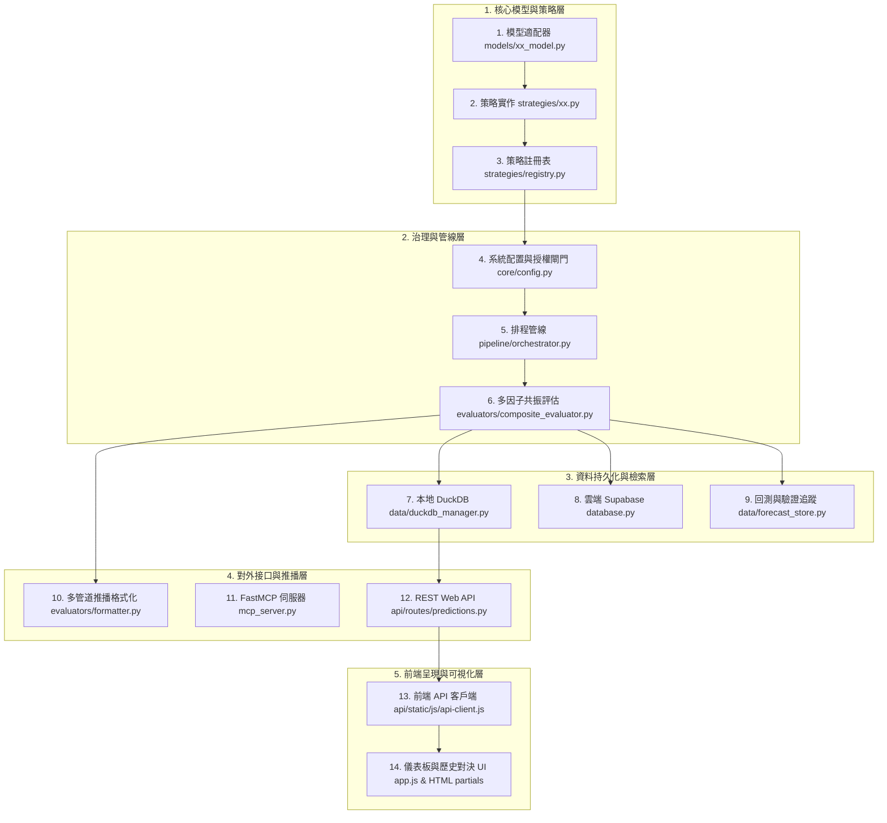
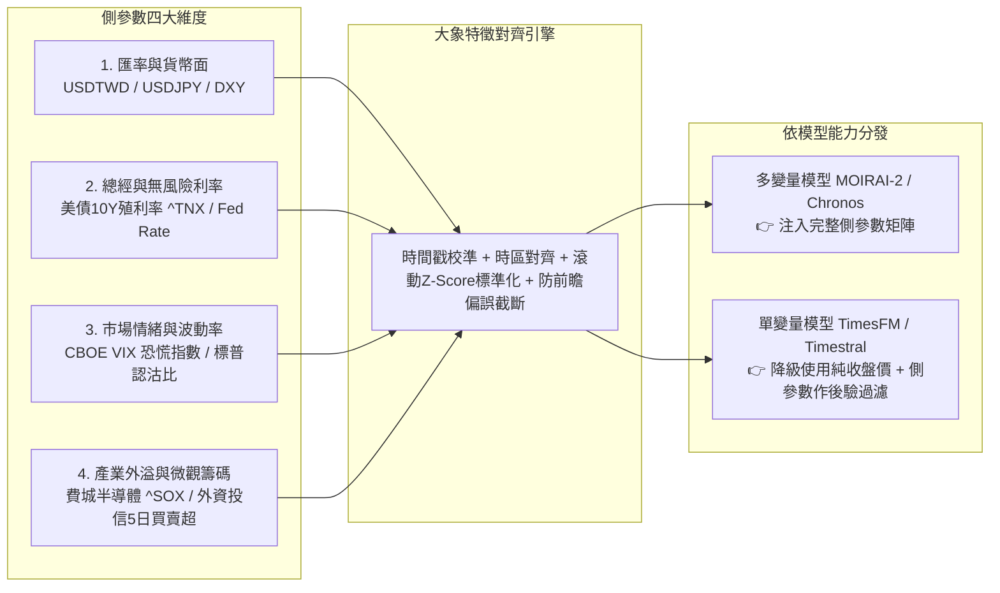

# 股票多維量化模型生命週期開發指南與熱插拔架構規劃書
> **版本**：v1.0 (2026-11-04)  
> **適用範圍**：時序基礎大模型（TimesFM, Timestral, MOIRAI-2 等）與量化策略之新增、刪除、參數調優與維護

---

## 一、 現行架構徹底盤點：加入或刪除一個模型需改動的 14 個層次

目前系統中新增一個時序基礎模型（如 TimesFM、Timestral、MOIRAI-2）或刪除舊模型（如 Deprecated LSTM），需貫穿整個前後端全鏈路，共計 **14 個關鍵層次**：



### 14 個層次詳細盤點與現行改動清單

| # | 模組層次 | 關鍵檔案 | 需實作 / 修改內容 | 潛在致命坑點 (Pitfalls) |
|---|---|---|---|---|
| **1** | **模型適配層** | `models/<name>_model.py` | 實作 `load_model()`、`forecast_batch()`、`quantiles` (P10~P90)、盈虧比計算；宣告是否接收側參數 (`supports_covariates`) | 依賴庫未安裝、權重下載卡住、HF Token 遺失、非確定性輸出、多變量特徵維度 mismatch |
| **2** | **策略封裝層** | `strategies/<name>.py` | 繼承 `BaseStrategy`，實作 `evaluate_batch(contexts)`，提取指標、消費側參數並計算候選分數 | 未處理 `features_unavailable` 降級、未處理跨市場時差、`Close` 不足 30 根未過濾 crash |
| **3** | **策略註冊層** | `strategies/registry.py` | `@register_strategy("<name>")`，並在 `orchestrator.py` import | 忘記 import 導致註冊表為空，工廠模式找不到策略實例 |
| **4** | **配置與授權** | `core/config.py` | 設定權重 `STRATEGY_WEIGHTS`、角色 `MODEL_ROLES`、授權 `usage_eligibility()` | 權重設為 0.0、角色停留在 shadow、合規檢查 `eligible: False` 攔截 |
| **5** | **管線排程層** | `pipeline/orchestrator.py` | 提取 `contexts`、K 線截斷 `retain_complete_bars`、特徵準備、呼叫批次推論 | **最大地雷**：若協變量下載失敗（429 Rate Limit）硬報錯導致所有模型集體罷工 |
| **6** | **綜合共振層** | `evaluators/composite_evaluator.py` | 多模型目標價動態加權合成、共振標籤 (`👑三大模型共振`)、位階判定 | 權重未動態正規化、目標價被單一模型覆蓋、標籤重複輸出 |
| **7** | **時序資料庫** | `data/duckdb_manager.py` | Schema 遷移加入 `<name>_predicted_price` 等 4 欄位，實作 top 查詢與聚合 | 欄位未宣告引發 SQL Binder Error、歷史查詢未 mapping `<name>_pred` |
| **8** | **雲端資料庫** | `database.py` | `save_dual_strategy_results` 寫入 Supabase `predictions` 表 | 缺少非空欄位防呆、JSON 欄位型態轉換錯誤 |
| **9** | **回測驗證層** | `data/forecast_store.py` | 保存每筆預測至 `forecast_records`，隔日由 cron 結算實際開獎價 | target_date 格式不一致、次日未收盤前誤開獎 |
| **10** | **推播日報層** | `evaluators/formatter.py` | 升級 Telegram (HTML)、Discord (MD)、Email (HTML) 排版與終端機表格 | 現價/目標價為 None 時格式化拋出 `TypeError` 導致整份推播中斷 |
| **11** | **MCP 服務層** | `mcp_server.py` | 註冊 `@mcp.tool(name="get_<name>_top_predictions")` | AI Agent 呼叫工具時缺少對應函式回報 404 |
| **12** | **Web API 層** | `api/routes/predictions.py` | 開放 `/api/v1/predictions/<name>/top-bullish` 與 `/top-bearish` | 缺少記憶體快取導致每次點擊重複掃描 DuckDB |
| **13** | **前端客戶端** | `api/static/js/api-client.js` | 增加 API 請求函式並註冊 WebMCP client tool | 函式名稱不一致導致前端非同步報錯 |
| **14** | **前端儀表板** | `app.js` & `tab_*.html` | 策略按鈕 `strategyOptions`、走勢圖折線、對決表欄位、PK 成績單卡片 | 歷史資料為空時顯示全 `-`、未處理舊版向後相容 |

---

## 二、 為什麼這次加入 MOIRAI-2 會踩坑？根本原因剖析

1. **協變量失敗導致的級聯癱瘓 (Cascading Failure)**：
   - 先前系統在 `pipeline/orchestrator.py` 強制採用 `FORECAST_FEATURE_PROFILE="full_features"`。
   - 當排程器並發抓取大盤指數（如 `^SOX`、`^N225`、`^VIX`）觸發 Yahoo Finance **HTTP 429 Too Many Requests (Rate limited)** 時，協變量矩陣全部變成 `features_unavailable`。
   - 舊版設計「未就緒即中斷」，導致 TimesFM、Timestral、MOIRAI-2 在 **0 毫秒內全數放棄推論**，回報 0 支預測。
   - **解法**：在 `pipeline/orchestrator.py` 實作自動平滑降級，若市場協變量不可用，自動切入 `price_only` 純時序預測，保證主幹預測絕不中斷。

2. **歷史預測數據空白未回填 (No Historical Backfill)**：
   - 使用者打開 `6770.T` 歷史對決表與 PK 成績單，發現 MOIRAI-2 欄位全是 `-`。
   - 原因：DuckDB 資料庫內只有過去未啟用 MOIRAI 時留下的舊記錄，當時 `moirai_predicted_price` 全為 `NULL`。
   - **解法**：編寫專屬回填腳本 `scripts/backfill_moirai_predictions.py`，切片回推過去 14 天各交易日收盤價，精確補回當時的模型目標價與分位數，讓歷史對決表與 PK 成績單立刻具有真實數據。

3. **模型改動跨度過廣、無熱插拔抽象 (Lack of Abstraction)**：
   - 增加一個模型需要在 14 個檔案、上百行程式碼中手動縫合。任何一處漏改（例如 DuckDB 漏加一個欄位或前端漏 mapping 一行），使用者就會看到破圖或缺漏。

---

## 三、 「大象與金魚」熱插拔架構演進規劃 (Elephant & Goldfish Architecture)

針對使用者提出的**「做熱插拔、台美日參數自適應、未來模型越來越多」**之深度架構需求，提出**「大象與金魚」設計模式**：

```
+-----------------------------------------------------------------------------------+
|                        🐘 大象底座 (The Elephant Base)                            |
|             穩固厚重、不隨模型增減而更動的核心引擎 (Zero Code Change on Core)        |
|  - 通用時序預測抽象協議 (ModelPluginProtocol)                                       |
|  - 泛型時序資料持久化 (Generic JSONB Forecast Schema: forecasts JSON)               |
|  - 統一加權集成與共振引擎 (Dynamic Consensus & Voting Engine)                       |
|  - 熔斷與平滑降級機制 (Graceful Fallback to Price-Only)                             |
+-----------------------------------------------------------------------------------+
                                         ▲
                                         │ 註冊與熱插拔
+-----------------------------------------------------------------------------------+
|                        🐟 金魚插件 (The Goldfish Plugins)                         |
|             靈活敏捷、秒級增刪、各自獨立的自描述外掛 (Self-Describing Plugins)       |
|  - TimesFM Plugin   - Timestral Plugin   - MOIRAI-2 Plugin   - Chronos Plugin...  |
|  - 宣告式 Metadata: name, license, market_compatibility, weights, quantiles       |
+-----------------------------------------------------------------------------------+
                                         ▲
                                         │ 動態讀取
+-----------------------------------------------------------------------------------+
|                   🌐 市場參數特化矩陣 (Market Parameter Overrides)                  |
|    台股 (TW)                   美股 (US)                     日股 (JP)             |
|    - 漲跌幅 ±10% 截斷          - 無漲跌幅限制                - 匯率敏感與 Tick 步長 |
|    - 隔日潛力門檻 0.5%         - 隔日潛力門檻 1.5%           - 隔日潛力門檻 0.8%    |
|    - Lookback 60 天            - Lookback 128 天             - Lookback 90 天      |
+-----------------------------------------------------------------------------------+
```

### 1. 金魚插件協議與生命週期勾子 (ModelPlugin Protocol & Lifecycle Hooks)

建立 `models/protocol.py`，未來任何新模型只需實作標準生命週期協議，即可完全熱插拔：

```python
from typing import Protocol, Dict, Any, List, Optional, runtime_checkable
import numpy as np

@runtime_checkable
class ModelPlugin(Protocol):
    """大象底座所依賴的標準化時序模型插件協議"""
    model_id: str                # 唯一識別碼，如 "moirai-2", "timesfm-2.0"
    display_name: str            # 介面顯示名稱，如 "Salesforce MOIRAI-2"
    version: str                 # 模型版本號，如 "2.0-R-small"
    author: str                  # 機構/作者，如 "Salesforce"
    supported_markets: List[str] # 支援市場清單 ["tw", "us", "jp"]
    default_role: str            # 預設角色: "active" | "shadow" | "candidate"
    
    # 🌟 側參數與協變量能力宣告 (Exogenous Covariate Capability)
    supports_covariates: bool    # 是否原生支援多變量/外部協變量 (如 MOIRAI-2: True, TimesFM 1.0: False)
    required_covariates: List[str] # 偏好或必備之側參數清單，如 ["vix", "usdtwd", "sox", "tnx"]

    def initialize(self, config: Dict[str, Any]) -> bool:
        """
        [生命週期勾子 1: 初始化與權重載入]
        下載並載入模型權重至指定運算設備 (CPU / MPS / CUDA)，配置 context 窗口與推論參數。
        若權重不存在或環境缺乏必要依賴，回傳 False 並記錄結構化 log，不可拋出未攔截異常。
        """
        ...

    def health_check(self) -> Dict[str, Any]:
        """
        [生命週期勾子 2: 健康檢查與設備探測]
        回傳設備狀態、記憶體佔用量、推論延遲基準 (Benchmark latency)，供管線判定是否熔斷降級。
        範例: {"status": "healthy", "device": "mps", "memory_mb": 420.5, "p99_latency_ms": 45.2}
        """
        ...

    def predict_batch(
        self, 
        series_dict: Dict[str, np.ndarray], 
        covariates_dict: Optional[Dict[str, Dict[str, np.ndarray]]] = None,
        horizon: int = 5,
        market: str = "tw",
        market_params: Optional[Dict[str, Any]] = None
    ) -> Dict[str, Dict[str, Any]]:
        """
        [生命週期勾子 3: 批次推論運算]
        標準輸入: 
          - series_dict: 標的日收盤價時序字典 (包含足額歷史天數)。
          - covariates_dict: 動態側參數特徵矩陣字典 (可選)，結構為:
            {
                "ticker": {
                    "vix": np.ndarray,       # 恐慌指數時序 (長度與 series 對齊)
                    "fx_rate": np.ndarray,   # 本地匯率時序 (USD/TWD, USD/JPY 或 DXY)
                    "yield_10y": np.ndarray, # 美債 10 年期殖利率時序 (^TNX)
                    "benchmark": np.ndarray, # 基準指數/板塊時序 (^SOX, ^TWII, ^N225)
                    "inst_flow": np.ndarray  # 法人籌碼/淨買賣動能時序 (台股特有)
                }
            }
          - horizon: 預測步長天數 (1, 5, 20)。
          - market: 目標市場代碼 ("tw", "us", "jp")。
          - market_params: 跨市場特化參數覆寫字典。

        標準輸出字典結構:
        {
            "ticker": {
                "predicted_price": float,           # P50 點預測目標價
                "potential": float,                 # 預期潛在漲跌幅 %
                "quantiles": {                      # 蒙地卡羅風控分位數
                    "p10": float, "p50": float, "p90": float
                },
                "trajectory": List[float],          # 各預測步長軌跡 (t+1 ... t+h)
                "risk_reward_ratio": float          # 預期盈虧比 (Upside / Downside)
            }
        }
        """
        ...

    def teardown(self) -> None:
        """
        [生命週期勾子 4: 資源釋放與優雅退出]
        清空 GPU/MPS 快取、釋放檔案鎖與模型推論環境，確保多進程或熱拔除時不發生記憶體洩漏。
        """
        ...
```

### 2. 動態側參數特徵矩陣架構 (Dynamic Exogenous Covariates Architecture)

純收盤價（Univariate Price-Only）僅能捕捉自回歸與動能慣性，無法感知宏觀流動性收縮、地緣政治恐慌或匯率劇震。大象底座將**「側參數 / 外部協變量」**定義為一等公民，建立 4 大維度與 3 大市場畫像：



#### 四大側參數特徵工程定義

| 側參數維度 | 關鍵指標代碼 | 數據源 (Fallback 鏈) | 經濟意涵與量化特徵提取 | 適用模型消費方式 |
|---|---|---|---|---|
| **匯率與貨幣面** | `USDTWD=X`<br/>`USDJPY=X`<br/>`DX-Y.NYB` | Yahoo Finance $\rightarrow$ Stale Cache | 衡量外資熱錢進出與出口匯損/匯兌收益。取 5 日變動率與乖離率。 | MOIRAI-2 協變量輸入；TimesFM 作為宏觀風控折扣係數 |
| **總經與無風險利率** | `^TNX` (美債10Y)<br/>`FEDFUNDS` | Yahoo Finance $\rightarrow$ FRED API $\rightarrow$ Cache | 科技高成長股折現率定價錨點。殖利率急升時對高 PE 標的估值施加折價。 | 協變量通道；高估值標的潛力扣減 |
| **市場情緒與波動率** | `^VIX`<br/>`^VXN` (NASDAQ) | Yahoo Finance $\rightarrow$ CBOE $\rightarrow$ Cache | 衡量全市場黑天鵝與系統性防守風險。VIX $> 25$ 時強制收縮預測目標價上行空間。 | 協變量通道；P10~P90 蒙地卡羅區間動態放大 |
| **產業外溢與籌碼** | `^SOX` (費城半導體)<br/>三大法人 5 日淨買超 | TWSE/TPEx $\rightarrow$ Yahoo Finance | 費半對台日半導體供應鏈（台積電、聯發科、阿爾卑斯阿爾派）具 1 天領先外溢效應。 | 直接納入台日半導體多變量時序通道 |

#### 跨市場特化側參數畫像 (Market Covariate Profiles)

```yaml
# config/market_covariates.yaml
covariate_profiles:
  tw:
    market_name: "台股 (TWSE/TPEx)"
    primary_fx: "USDTWD=X"                # 台幣匯率 (外資動向先行指標)
    external_spillover: "^SOX"             # 費城半導體 (高達 0.85 相關度)
    domestic_benchmark: "^TWII"            # 台灣加權指數
    sentiment_index: "^VIX"                # 全球恐慌情緒
    macro_interest_rate: "^TNX"            # 美債 10 年期殖利率
    micro_chip_features:                   # 💡 台灣特有籌碼面特徵 (高權重)
      foreign_net_5d: true                 # 外資 5 日累計買賣超
      trust_net_5d: true                   # 投信 5 日累計買賣超
      margin_balance_change: true          # 融資餘額變化
    covariate_lookback: 60                 # 側參數回溯天數 (交易日)
    missing_imputation: "forward_fill"     # 遇台美休市不同步時採用前向填充

  us:
    market_name: "美股 (NYSE/NASDAQ)"
    primary_fx: "DX-Y.NYB"                 # 美元指數 (DXY)
    external_spillover: null               # 美股為全球源頭，無外部領先指數
    domestic_benchmark: "^GSPC"            # S&P 500 大盤 Beta
    sentiment_index: "^VIX"                # 恐慌指數 (高靈敏度)
    macro_interest_rate: "^TNX"            # 10Y 美債 (直接影響科技巨頭 DCF 估值)
    micro_chip_features:                   # 💡 美股不適用台灣法人分點籌碼
      foreign_net_5d: false
      trust_net_5d: false
    covariate_lookback: 128                # 季度宏觀長回看天數
    missing_imputation: "linear_interp"

  jp:
    market_name: "日股 (Tokyo Stock Exchange)"
    primary_fx: "USDJPY=X"                 # 日圓匯率 (出口巨頭命脈、套息交易關聯)
    external_spillover: "^SOX"             # 隔夜美股與費半連動
    domestic_benchmark: "^N225"            # 日經 225
    sentiment_index: "^VIX"                # 全球恐慌情緒
    macro_interest_rate: "^TNX"            # 美債利差
    micro_chip_features:
      foreign_net_5d: false
      trust_net_5d: false
    covariate_lookback: 90
    missing_imputation: "forward_fill"
```

#### 側參數前處理與防前瞻偏誤鐵律 (Lookahead-Free Engineering)
1. **嚴格 K 線截斷 (`retain_complete_bars`)**：側參數時間戳必須與個股收盤價完全同頻。若在盤前執行（如 08:00 台股盤前），美股 `^SOX` 與 `^VIX` 使用前一晚已收盤之終值，嚴禁使用尚未走完之即時盤中資料。
2. **滾動 Robust 標準化 (Stationarity & Scaling)**：
   - 價格類（匯率、指數）一律轉換為「對數收益率（Log Returns）」或「相對 20MA 乖離率（BIAS%）」，杜絕絕對點位量綱爆炸。
   - 籌碼類（張數、金額）進行「除以股本之週轉率正規化」或「滾動 60 日分位數 Rank 映射」。
3. **三級平滑降級鏈 (Degradation Fallback Chain)**：
   - **Tier 1 (全特徵)**：個股收盤價 + 總經匯率 + 籌碼協變量均完整就緒 $\rightarrow$ 執行最高精度多變量推論。
   - **Tier 2 (核心側參數)**：籌碼缺失或 429 $\rightarrow$ 僅以匯率與大盤指数對齊後推論。
   - **Tier 3 (純收盤價 Price-Only)**：Yahoo Finance 全面 429 觸發熔斷 $\rightarrow$ 自動無縫切入純時序收盤價模式，模型照常輸出預測，**決策永不中斷**。

---

### 3. 側參數金魚熱插拔架構 (Hot-Pluggable Covariate & Feature Pipeline)

不只時序大模型需要熱插拔，**側參數本身也必須是「可隨時宣告、隨時熱插拔、秒級拔除與隔離」的金魚外掛（Hot-Pluggable Covariate Plugins）**。

#### 核心設計理念：零代碼修改擴充側參數 (Zero Code Change on Covariates)
未來若要增加「黃金期貨 (GC=F)」、「比特幣流動性 (BTC-USD)」、「日銀政策利率利差」或「台股外資期貨淨未平倉口數」，**嚴禁在 Python 底座中硬編碼手寫 `if-else`**。全面透過宣告式配置與插件協議動態註冊：

```mermaid
flowchart TD
    subgraph 宣告式側參數清單 config/covariates.yaml
        CFG["📄 宣告式側參數設定檔<br/>- id: GOLD, symbol: GC=F<br/>- id: BTC, symbol: BTC-USD<br/>- id: VIX, symbol: ^VIX"]
    end

    subgraph 側參數熱插拔工廠 (Covariate Registry & Factory)
        REG["動態插件註冊表 (CovariatePluginRegistry)<br/>- 動態載入 Provider (Yahoo / FRED / TWSE / Custom API)<br/>- 監聽檔案熱變更 (Hot-Reload without Restart)"]
    end

    subgraph 單點故障隔離與熱拔除 (Hot-Unplug & Fault Isolation)
        ISO{"健康探針與熔斷檢測"}
        OK["✅ 正常特徵通道 (注入矩陣)"]
        FAIL["⚠️ 單點異常 (如 FRED API 429 超時)<br/>👉 僅秒級熱拔除該指標，其餘側參數照常運作"]
    end

    subgraph 動態特徵矩陣裝配器 (Dynamic Feature Matrix Assembler)
        ASM["按市場 (TW/US/JP) 與模型需求自動拼裝 (T, K) 矩陣<br/>特徵維度從 (T, 4) 自適應擴展為 (T, 5)"]
    end

    CFG --> REG
    REG --> ISO
    ISO -->|健康| OK
    ISO -->|異常| FAIL
    OK --> ASM
    FAIL -->|安全隔離| ASM
```

#### 1. 側參數插件協議定義 (`CovariatePluginProtocol`)

```python
@runtime_checkable
class CovariatePlugin(Protocol):
    """側參數插件生命週期標準協議"""
    covariate_id: str           # 唯一指標代碼，如 "GOLD", "BTC", "VIX", "USDTWD"
    label: str                  # 顯示標籤，如 "Comex Gold Futures"
    source_type: str            # 數據源驅動: "yahoo" | "fred" | "twse" | "custom_http"
    source_code: str            # 上游查詢符號，如 "GC=F", "DGS10"
    market_affinity: List[str]  # 適用市場清單，如 ["tw", "us", "jp"]
    category: str               # 類別: "macro" | "fx" | "sentiment" | "commodity" | "chips"
    normalization_mode: str     # 標準化策略: "log_returns" | "rolling_zscore" | "bias_ma20"
    update_frequency: str       # 更新頻率: "daily_close" | "hourly" | "tick"
    
    def fetch_observations(self, start_date: str, end_date: str) -> pd.Series:
        """從上游抓取歷史觀測值時序，具備 Stale Cache 備援"""
        ...
        
    def transform(self, raw_series: pd.Series, lookback: int = 60) -> np.ndarray:
        """執行非線性平穩化與防前瞻截斷，輸出標準化浮點陣列"""
        ...

    def health_check(self) -> bool:
        """上游可用性探測，若持續 429 則主動回報 False 觸發平滑熱拔除"""
        ...
```

#### 2. 宣告式動態配置範例 (`config/covariates_registry.yaml`)

維運人員或量化研究員只需在 YAML 新增項目，系統自動完成抓取、快取、標準化與推論矩陣注入：

```yaml
# config/covariates_registry.yaml
covariates_registry:
  # 🌟 避險資產：黃金期貨 (全面支援台美日)
  - id: "GOLD"
    label: "Comex Gold Continuous Futures"
    source_type: "yahoo"
    source_code: "GC=F"
    market_affinity: ["tw", "us", "jp"]
    category: "commodity"
    normalization_mode: "log_returns"
    lookback: 60
    fallback_policy: "stale_cache"
    circuit_breaker_retries: 3

  # 🌟 流動性先行指標：比特幣現貨 (美股與全球科技風險情緒)
  - id: "BITCOIN"
    label: "Bitcoin / USD Spot"
    source_type: "yahoo"
    source_code: "BTC-USD"
    market_affinity: ["us", "tw"]
    category: "crypto_liquidity"
    normalization_mode: "rolling_zscore"
    lookback: 60
    fallback_policy: "forward_fill"

  # 🌟 恐慌情緒：CBOE VIX 波動率
  - id: "VIX"
    label: "CBOE Volatility Index"
    source_type: "yahoo"
    source_code: "^VIX"
    market_affinity: ["tw", "us", "jp"]
    category: "sentiment"
    normalization_mode: "bias_ma20"
    lookback: 60

  # 🌟 跨國匯率：美元兌台幣
  - id: "USDTWD"
    label: "USD / TWD Spot"
    source_type: "yahoo"
    source_code: "USDTWD=X"
    market_affinity: ["tw"]
    category: "fx"
    normalization_mode: "log_returns"
    lookback: 60
```

#### 3. 動態特徵矩陣裝配器 (Dynamic Feature Matrix Assembler)
- **維度自適應**：推論管線啟動時，特徵裝配器自動過濾 `covariates_registry` 中匹配當前 `market` 且通過健康檢查的側參數清單。
- **無縫擴充**：若啟用 4 個側參數，裝配出的矩陣形狀為 $(T, 4)$；若新增黃金與比特幣，形狀動態擴充為 $(T, 6)$。
- **模型自適應消費**：
  - **多變量模型（如 MOIRAI-2）**：自動將 $K$ 個通道透過 `past_covariates` 饋入 Transformer 注意力機制。
  - **單變量模型（如 TimesFM 1.0）**：自動忽略特徵矩陣，僅使用純收盤價推論；同時將側參數作為事後風控過濾器（例如 VIX $> 25$ 或台幣重貶時扣減潛力）。

#### 4. 側參數單點隔離與熱拔除防護機制 (Fault Isolation & Hot-Unplug)
- **防雪崩設計（Anti-Cascading Architecture）**：過去系統最大的痛點是「因單一指標（如 `^SOX`）429 失敗，導致所有時序模型完全放棄推論」。
- **熱拔除策略（Hot-Unplug Policy）**：
  1. 每個側參數獨立計時與熔斷（Circuit Breaker）。
  2. 若某指標（如黃金期貨）網路異常，特徵裝配器**僅動態剔除該單一特徵**，矩陣由 $(T, 6)$ 降級為 $(T, 5)$，其餘 5 個特徵照常注入推論！
  3. 若所有外部側參數全部中斷，管線平滑降級為 Tier 3（純收盤價 Price-Only），**杜絕全盤停擺**。
- **熱重載（Hot-Reload without Restart）**：
  - 排程管線每次批次執行前比對 `covariates_registry.yaml` 之 MD5 雜湊值。
  - 若設定更新，記憶體中即時熱重載側參數實例，免重新部署容器，維運秒級生效。

---

### 4. 跨市場特化動態參數矩陣 (Cross-Market Parameter Overrides)

不同市場具有截然不同的交易機制、波動率特徵與預測視野。大象底座透過動態參數矩陣統一向各金魚插件注入市場專屬約束：

```yaml
# config/market_parameters.yaml
market_matrix:
  tw:
    market_name: "台股 (TWSE/TPEx)"
    default_horizons: [1, 5]               # 隔日與週波段
    max_daily_change_pct: 10.0             # 台股漲跌幅 10% 剛性限制 (防呆截斷)
    volatility_scaling: "atr_capped"       # ATR 波動正規化，封頂 ±10%
    min_potential_threshold: 0.5           # 看漲最小潛力門檻 (%)
    lookback_window: 60                    # 歷史日 K 回看天數
    broker_chips_weight: 0.25              # 台灣三大法人與主力券商特有籌碼權重

  us:
    market_name: "美股 (NYSE/NASDAQ)"
    default_horizons: [1, 5, 20]           # 美股支援隔日、週波段與月波段 (20日)
    max_daily_change_pct: null             # 美股無漲跌幅限制 (No circuit collar)
    volatility_scaling: "realized_vol"     # 歷史 20 日真實已實現波動率動態縮放
    min_potential_threshold: 1.5           # 美股高波動，門檻放寬至 1.5%
    lookback_window: 128                   # 歷史長窗口回看 (抓取季度宏觀循環)
    broker_chips_weight: 0.00              # 💡 美股不適用台灣法人分點籌碼，權重歸零並在 UI 提供提示

  jp:
    market_name: "日股 (Tokyo Stock Exchange)"
    default_horizons: [1, 5]
    max_daily_change_pct: null             # 依呼叫價位階段限價 (Tick Tier)
    volatility_scaling: "fx_adjusted_vol"  # 匯率敏感度 (JPY/USD) 波動修正
    min_potential_threshold: 0.8           # 日股震盪門檻
    lookback_window: 90                    # 季度日 K 回看
    broker_chips_weight: 0.00              # 日股籌碼權重歸零
```

### 5. 動態集成權重與滾動勝率引擎 (Dynamic Ensemble & Rolling Win-Rate)

大象底座不應採用寫死的靜態權重（如各 33%），而是建立**滾動 30 交易日真實開獎勝率的動態 Softmax 集成機制**：

$$\tilde{w}_m = \text{Softmax}\left( \frac{\text{HitRate}_{m, 30d} \times (1 - \text{MAPE}_{m, 30d})}{\tau} \right)$$

1. **實盤結算追蹤**：每日收盤後，`ForecastStore` 透過實際收盤價結算歷史各模型的方向命中率（Hit Rate）與絕對誤差百分比（MAPE）。
2. **動態溫控 Softmax**：表現較佳的模型自動獲得更高集成話語權；若某模型近期勝率跌破 50%，權重自動衰減並觸發低命中率警示。
3. **共振判定解耦**：改為泛型標籤輸出：當超過 $K$ 個模型同時預測隔日漲幅超過市場門檻時，自動打上 `👑 多模型共振 (K/N)` 標籤，徹底告別「雙維共振」、「三大模型共振」的硬編碼。

---

## 四、 「金魚記憶」微觀陷阱防護指南 (Goldfish Traps & Single-Point Failure Defenses)

在宏觀架構之外，系統最常因微觀工程細節（7 秒記憶陷阱）而發生雪崩式崩潰。本節詳列四大致命坑點與硬核防禦機制：

### 陷阱 1：DuckDB 單進程排他寫入鎖與多進程並發衝突
- **血淋淋根因**：DuckDB 採用單進程寫入排他鎖（File Lock）。當背景 Cron Job 或批次推論進程正在寫入資料庫時，FastAPI Web API 若預設使用 `read_only=False` 建立連線，會立刻拋出 `_duckdb.IOException: Conflicting lock is held to database`，引發 HTTP 500。
- **金魚防護規範**：
  1. **讀取預設全面 `read_only=True`**：`DuckDBManager.query()` 與所有 `get_*` 讀取方法必須強制預設 `read_only=True`。DuckDB 允許多個進程同時以唯讀模式連線。
  2. **檔案不存在先初始化**：DuckDB 若在檔案不存在時以唯讀開啟會報錯，因此連線工廠必須先確認檔案存在，未存在時於全域安全鎖內完成結構初始化。
  3. **指數退避重試迴圈 (Exponential Backoff)**：遇到 `conflicting lock` 或 `could not set lock` 時，讀取連線進行最多 5 次退避重試（`0.2s * 2^attempt`）；寫入連線進行 3 次重試，絕不直接讓 API 拋出未捕獲例外。

### 陷阱 2：N+1 儲存連線鎖死磁碟 I/O
- **血淋淋根因**：`ForecastStore.record_forecast` 過去在迴圈內部逐筆呼叫 `with self._connect() as con:`。在 850 檔台股 × 3 個模型 × 2 個 Horizon 的場景下，單一排程產生超過 **5,100 次連續連線、解鎖、重連**，引發嚴重磁碟 I/O 爭奪，排他鎖佔用時間延長數倍。
- **金魚防護規範**：
  1. **強制批次寫入**：實作 `record_forecasts_batch(forecasts)`，在單一 `with self._lock(), self._connect() as con:` 連線與單一資料庫交易（Single Transaction）中完成成千上萬筆寫入。
  2. **管線集成層呼叫**：`pipeline/forecast_integration.py` 收集全部標的預測後一次性批次提交，將磁碟鎖定時間由數十秒縮減至數十毫秒。

### 陷阱 3：前端 `Promise.catch(() => [])` 靜默吞錯導致白屏
- **血淋淋根因**：前端在呼叫後端 API 時，工程師為了防崩潰常撰寫 `.catch(() => [])`。當後端因資料庫鎖衝突或 500 錯誤時，前端靜默收到空陣列，直接觸發「查無資料」，完全沒有錯誤日誌與重新整理按鈕，讓維運人員誤以為是模型沒有計算。
- **金魚防護規範**：
  1. **區分空資料與錯誤狀態**：前端必須維護 `loadError` 與 `hasSearched` 狀態，若 API 發生 HTTP 非 200 錯誤，必須渲染明確的警示卡片與「重新整理」按鈕。
  2. **外國標的與空狀態引導**：
     - 若為美股/外國標的，在籌碼區明確提示：「💡 本標的為美股/外國標的，不適用台灣三大法人籌碼數據」。
     - 若標的歷史筆數為 0，提示：「🌱 該標的甫納入追蹤清單，或尚無已開獎之時序預測」。

### 陷阱 4：硬編碼模型名稱在 14 個層次處處洩漏
- **血淋淋根因**：在程式碼中寫死 `if model == 'TimesFM' and model == 'Timestral': '雙維共振'`，導致加入 MOIRAI-2 時，UI 篩選按鈕缺漏、Email 日報缺漏、Telegram 播報缺漏、歷史對決表破圖。
- **金魚防護規範**：
  1. **以策略集合（Set of active models）取代二元邏輯**。
  2. **推播與看板全面依據動態註冊表渲染**，歷史對決表針對未開跑的模型預測欄位安全渲染 `-`，禁止進行 `Number('-').toFixed()` 運算。

---

## 五、 現行標準維護 SOP：若要加入或刪除新模型的操作步驟

在熱插拔架構全面上線前，維護現有代碼庫需嚴格遵守以下步驟：

### 新增模型 7 步清單
1. **編寫模型適配器**：在 `models/` 下新增，實現 batch forecast 與 9 分位數。
2. **編寫策略類別**：在 `strategies/` 下新增，使用 `@register_strategy` 註冊，並在 `strategies/registry.py` 或 `orchestrator.py` import。
3. **配置授權與權重**：在 `core/config.py` 加入 `STRATEGY_WEIGHTS`、`MODEL_ROLES` 與 `usage_eligibility()`。
4. **資料庫遷移**：在 `data/duckdb_manager.py` 的 table 初始化加入新欄位，並擴充 `save_dual_strategy_results`。
5. **推播與評估合成**：在 `evaluators/composite_evaluator.py` 納入合成加權與共振計數；在 `evaluators/formatter.py` 加入排版。
6. **Web API & 前端**：在 `api/routes/predictions.py`、`api-client.js`、`app.js` 與 `tab_history.html` 補上映射。
7. **歷史回填與驗證**：運行回填腳本補齊既有數據，確保歷史走勢與計分卡不掛零。

### 刪除 / 下線模型 3 步清單
1. **降級為候選或移除權重**：在 `core/config.py` 將權重設為 `0.0`，角色設為 `"deprecated"`。
2. **評估合成排除**：在 `evaluators/composite_evaluator.py` 確保 `active_weights` 動態過濾，不參與目標價計算與共振判定。
3. **保留資料庫欄位以向下相容**：不可刪除 DuckDB 舊欄位，以避免歷史回測與歷史走勢圖報錯。
