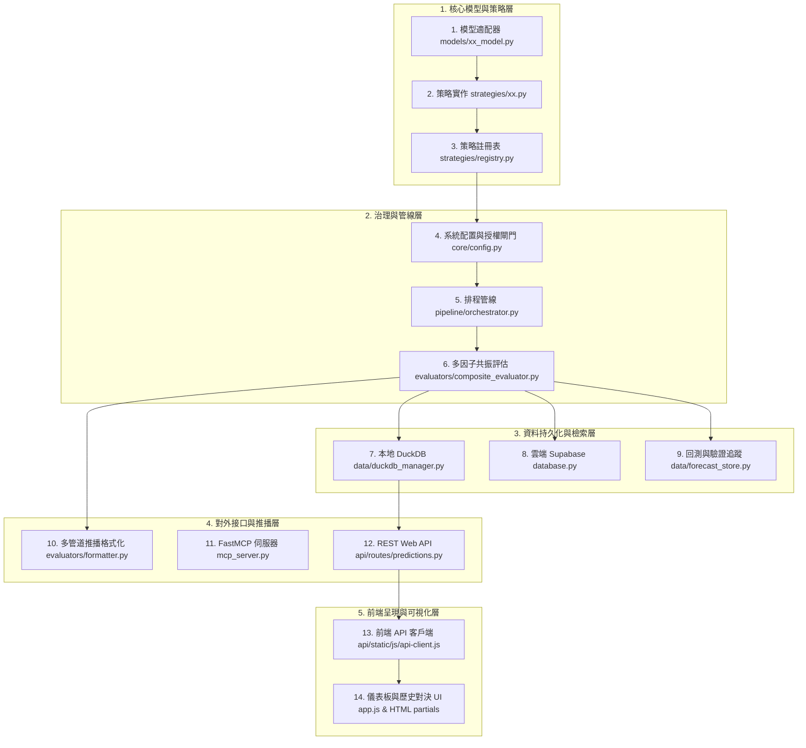

# 股票多維量化模型生命週期開發指南與熱插拔架構規劃書
> **版本**：v1.0 (2026-11-04)  
> **適用範圍**：時序基礎大模型（TimesFM, Timestral, MOIRAI-2 等）與量化策略之新增、刪除、參數調優與維護

---

## 一、 現行架構徹底盤點：加入或刪除一個模型需改動的 14 個層次

目前系統中新增一個時序基礎模型（如 TimesFM、Timestral、MOIRAI-2）或刪除舊模型（如 Deprecated LSTM），需貫穿整個前後端全鏈路，共計 **14 個關鍵層次**：



### 14 個層次詳細盤點與現行改動清單

| # | 模組層次 | 關鍵檔案 | 需實作 / 修改內容 | 潛在致命坑點 (Pitfalls) |
|---|---|---|---|---|
| **1** | **模型適配層** | `models/<name>_model.py` | 實作 `load_model()`、`forecast_batch()`、`quantiles` (P10~P90)、盈虧比計算 | 依賴庫未安裝、權重下載卡住、HF Token 遺失、非確定性輸出 |
| **2** | **策略封裝層** | `strategies/<name>.py` | 繼承 `BaseStrategy`，實作 `evaluate_batch(contexts)`，提取指標與候選分數 | 未處理 `features_unavailable`、`Close` 不足 30 根未過濾 crash |
| **3** | **策略註冊層** | `strategies/registry.py` | `@register_strategy("<name>")`，並在 `orchestrator.py` import | 忘記 import 導致註冊表為空，工廠模式找不到策略實例 |
| **4** | **配置與授權** | `core/config.py` | 設定權重 `STRATEGY_WEIGHTS`、角色 `MODEL_ROLES`、授權 `usage_eligibility()` | 權重設為 0.0、角色停留在 shadow、合規檢查 `eligible: False` 攔截 |
| **5** | **管線排程層** | `pipeline/orchestrator.py` | 提取 `contexts`、K 線截斷 `retain_complete_bars`、特徵準備、呼叫批次推論 | **最大地雷**：若協變量下載失敗（429 Rate Limit）硬報錯導致所有模型集體罷工 |
| **6** | **綜合共振層** | `evaluators/composite_evaluator.py` | 多模型目標價動態加權合成、共振標籤 (`👑三大模型共振`)、位階判定 | 權重未動態正規化、目標價被單一模型覆蓋、標籤重複輸出 |
| **7** | **時序資料庫** | `data/duckdb_manager.py` | Schema 遷移加入 `<name>_predicted_price` 等 4 欄位，實作 top 查詢與聚合 | 欄位未宣告引發 SQL Binder Error、歷史查詢未 mapping `<name>_pred` |
| **8** | **雲端資料庫** | `database.py` | `save_dual_strategy_results` 寫入 Supabase `predictions` 表 | 缺少非空欄位防呆、JSON 欄位型態轉換錯誤 |
| **9** | **回測驗證層** | `data/forecast_store.py` | 保存每筆預測至 `forecast_records`，隔日由 cron 結算實際開獎價 | target_date 格式不一致、次日未收盤前誤開獎 |
| **10** | **推播日報層** | `evaluators/formatter.py` | 升級 Telegram (HTML)、Discord (MD)、Email (HTML) 排版與終端機表格 | 現價/目標價為 None 時格式化拋出 `TypeError` 導致整份推播中斷 |
| **11** | **MCP 服務層** | `mcp_server.py` | 註冊 `@mcp.tool(name="get_<name>_top_predictions")` | AI Agent 呼叫工具時缺少對應函式回報 404 |
| **12** | **Web API 層** | `api/routes/predictions.py` | 開放 `/api/v1/predictions/<name>/top-bullish` 與 `/top-bearish` | 缺少記憶體快取導致每次點擊重複掃描 DuckDB |
| **13** | **前端客戶端** | `api/static/js/api-client.js` | 增加 API 請求函式並註冊 WebMCP client tool | 函式名稱不一致導致前端非同步報錯 |
| **14** | **前端儀表板** | `app.js` & `tab_*.html` | 策略按鈕 `strategyOptions`、走勢圖折線、對決表欄位、PK 成績單卡片 | 歷史資料為空時顯示全 `-`、未處理舊版向後相容 |

---

## 二、 為什麼這次加入 MOIRAI-2 會踩坑？根本原因剖析

1. **協變量失敗導致的級聯癱瘓 (Cascading Failure)**：
   - 先前系統在 `pipeline/orchestrator.py` 強制採用 `FORECAST_FEATURE_PROFILE="full_features"`。
   - 當排程器並發抓取大盤指數（如 `^SOX`、`^N225`、`^VIX`）觸發 Yahoo Finance **HTTP 429 Too Many Requests (Rate limited)** 時，協變量矩陣全部變成 `features_unavailable`。
   - 舊版設計「未就緒即中斷」，導致 TimesFM、Timestral、MOIRAI-2 在 **0 毫秒內全數放棄推論**，回報 0 支預測。
   - **解法**：在 `pipeline/orchestrator.py` 實作自動平滑降級，若市場協變量不可用，自動切入 `price_only` 純時序預測，保證主幹預測絕不中斷。

2. **歷史預測數據空白未回填 (No Historical Backfill)**：
   - 使用者打開 `6770.T` 歷史對決表與 PK 成績單，發現 MOIRAI-2 欄位全是 `-`。
   - 原因：DuckDB 資料庫內只有過去未啟用 MOIRAI 時留下的舊記錄，當時 `moirai_predicted_price` 全為 `NULL`。
   - **解法**：編寫專屬回填腳本 `scripts/backfill_moirai_predictions.py`，切片回推過去 14 天各交易日收盤價，精確補回當時的模型目標價與分位數，讓歷史對決表與 PK 成績單立刻具有真實數據。

3. **模型改動跨度過廣、無熱插拔抽象 (Lack of Abstraction)**：
   - 增加一個模型需要在 14 個檔案、上百行程式碼中手動縫合。任何一處漏改（例如 DuckDB 漏加一個欄位或前端漏 mapping 一行），使用者就會看到破圖或缺漏。

---

## 三、 「大象與金魚」熱插拔架構演進規劃 (Elephant & Goldfish Architecture)

針對使用者提出的**「做熱插拔、台美日參數自適應、未來模型越來越多」**之深度架構需求，提出**「大象與金魚」設計模式**：

```
+-----------------------------------------------------------------------------------+
|                        🐘 大象底座 (The Elephant Base)                            |
|             穩固厚重、不隨模型增減而更動的核心引擎 (Zero Code Change on Core)        |
|  - 通用時序預測抽象協議 (ModelPluginProtocol)                                       |
|  - 泛型時序資料持久化 (Generic JSONB Forecast Schema: forecasts JSON)               |
|  - 統一加權集成與共振引擎 (Dynamic Consensus & Voting Engine)                       |
|  - 熔斷與平滑降級機制 (Graceful Fallback to Price-Only)                             |
+-----------------------------------------------------------------------------------+
                                         ▲
                                         │ 註冊與熱插拔
+-----------------------------------------------------------------------------------+
|                        🐟 金魚插件 (The Goldfish Plugins)                         |
|             靈活敏捷、秒級增刪、各自獨立的自描述外掛 (Self-Describing Plugins)       |
|  - TimesFM Plugin   - Timestral Plugin   - MOIRAI-2 Plugin   - Chronos Plugin...  |
|  - 宣告式 Metadata: name, license, market_compatibility, weights, quantiles       |
+-----------------------------------------------------------------------------------+
                                         ▲
                                         │ 動態讀取
+-----------------------------------------------------------------------------------+
|                   🌐 市場參數特化矩陣 (Market Parameter Overrides)                  |
|    台股 (TW)                   美股 (US)                     日股 (JP)             |
|    - 漲跌幅 ±10% 截斷          - 無漲跌幅限制                - 匯率敏感與 Tick 步長 |
|    - 隔日潛力門檻 0.5%         - 隔日潛力門檻 1.5%           - 隔日潛力門檻 0.8%    |
|    - Lookback 60 天            - Lookback 128 天             - Lookback 90 天      |
+-----------------------------------------------------------------------------------+
```

### 1. 金魚插件協議 (Self-Describing Plugin Protocol)

建立 `models/protocol.py`，未來任何新模型只需實作此抽象介面並放入 `models/plugins/`：

```python
from typing import Protocol, Dict, Any, List, Optional
import numpy as np

class TimeSeriesModelPlugin(Protocol):
    model_id: str              # 唯一識別碼，如 "moirai-2"
    display_name: str          # 顯示名稱，如 "MOIRAI-2"
    version: str               # 版本號，如 "2.0-R-small"
    author: str                # 開發機構，如 "Salesforce"
    supported_markets: List[str] # 支援市場 ["tw", "us", "jp"]
    default_role: str          # 預設角色: "active" | "shadow" | "candidate"
    
    def predict_batch(
        self, 
        series_dict: Dict[str, np.ndarray], 
        horizon: int = 5,
        market: str = "tw",
        market_params: Optional[Dict[str, Any]] = None
    ) -> Dict[str, Dict[str, Any]]:
        """
        回傳標準化預測字典:
        {
            "ticker": {
                "predicted_price": float,
                "potential": float,
                "quantiles": {"p10": float, "p50": float, "p90": float},
                "trajectory": List[float],
                "risk_reward_ratio": float
            }
        }
        """
        ...
```

### 2. 市場特化動態參數矩陣 (`config/models_market.yaml`)

不再將超參數寫死在 Python 程式碼中，而是使用設定檔按市場分離：

```yaml
models:
  moirai:
    enabled: true
    weights:
      tw: 0.15
      us: 0.20
      jp: 0.15
    market_params:
      tw:
        min_potential: 0.5       # 台股防禦保守
        max_daily_change: 10.0   # 台股漲跌幅限制防呆
        context_len: 64
      us:
        min_potential: 1.5       # 美股波動較大，門檻放寬
        max_daily_change: null   # 無限制
        context_len: 128
      jp:
        min_potential: 0.8
        context_len: 96

  timesfm:
    enabled: true
    weights:
      tw: 0.20
      us: 0.25
      jp: 0.20

  timestral:
    enabled: true
    weights:
      tw: 0.20
      us: 0.20
      jp: 0.15
```

### 3. 大象儲存層泛化：從硬編碼欄位到通用結構 (Generic Forecast Storage)

現行方案：
`moirai_predicted_price`, `timesfm_predicted_price`, `timestral_predicted_price` ... 每加一個模型就要 `ALTER TABLE ADD COLUMN`。

演進方案：
在 DuckDB 與 Supabase 保留向下相容視圖的同時，底層採用泛型 JSONB 存儲：
```sql
CREATE TABLE predictions_v3 (
    id UUID PRIMARY KEY,
    ticker VARCHAR NOT NULL,
    market VARCHAR NOT NULL,
    timestamp TIMESTAMP WITH TIME ZONE NOT NULL,
    current_price DOUBLE NOT NULL,
    composite_predicted_price DOUBLE,
    composite_potential DOUBLE,
    active_consensus_count INTEGER,     -- 當日共振模型數量 (例如 3/3 模型看漲)
    model_forecasts JSON,               -- {"timesfm": {...}, "moirai": {...}, "timestral": {...}}
    tags VARCHAR[]
);
```

### 4. 前端自適應動態渲染 (Self-Rendering Dashboard UI)

- 前端在初始化時呼叫 `/api/v1/models/meta`。
- API 回傳當前市場啟用的模型清單：
  ```json
  [
    {"id": "timesfm", "label": "TimesFM 看漲排行", "icon": "auto_awesome", "color": "#7C3AED"},
    {"id": "timestral", "label": "Timestral 看漲排行", "icon": "smart_toy", "color": "#D97706"},
    {"id": "moirai", "label": "MOIRAI-2 看漲排行", "icon": "psychology", "color": "#0284C7"}
  ]
  ```
- 前端 `v-for="model in activeModels"` 自動生成按鈕、走勢折線與 PK 對決表欄位。
- **未來加入第 4 個、第 5 個模型時，前端 0 行代碼修改，立即上線！**

---

## 四、 現行標準維護 SOP：若要加入或刪除新模型的操作步驟

在熱插拔架構全面上線前，維護現有代碼庫需嚴格遵守以下步驟：

### 新增模型 7 步清單
1. **編寫模型適配器**：在 `models/` 下新增，實現 batch forecast 與 9 分位數。
2. **編寫策略類別**：在 `strategies/` 下新增，使用 `@register_strategy` 註冊，並在 `strategies/registry.py` 或 `orchestrator.py` import。
3. **配置授權與權重**：在 `core/config.py` 加入 `STRATEGY_WEIGHTS`、`MODEL_ROLES` 與 `usage_eligibility()`。
4. **資料庫遷移**：在 `data/duckdb_manager.py` 的 table 初始化加入新欄位，並擴充 `save_dual_strategy_results`。
5. **推播與評估合成**：在 `evaluators/composite_evaluator.py` 納入合成加權與共振計數；在 `evaluators/formatter.py` 加入排版。
6. **Web API & 前端**：在 `api/routes/predictions.py`、`api-client.js`、`app.js` 與 `tab_history.html` 補上映射。
7. **歷史回填與驗證**：運行回填腳本補齊既有數據，確保歷史走勢與計分卡不掛零。

### 刪除 / 下線模型 3 步清單
1. **降級為候選或移除權重**：在 `core/config.py` 將權重設為 `0.0`，角色設為 `"deprecated"`。
2. **評估合成排除**：在 `evaluators/composite_evaluator.py` 確保 `active_weights` 動態過濾，不參與目標價計算與共振判定。
3. **保留資料庫欄位以向下相容**：不可刪除 DuckDB 舊欄位，以避免歷史回測與歷史走勢圖報錯。
