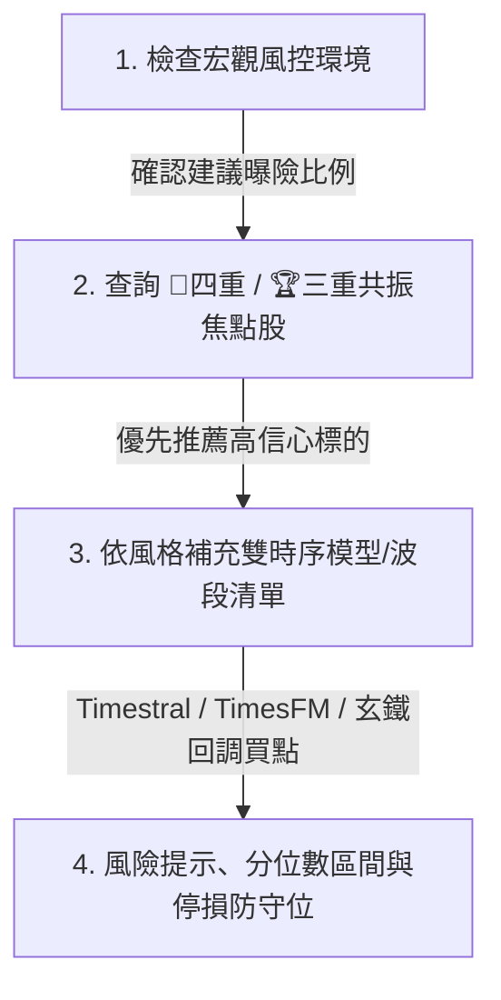

# 📈 888 Stock Quant Agent Skill

> 🔄 **Continuous Feature Evolution Active**：本量化大腦系統持續增強模型、端點與資料來源。請調用本 Skill 的外部 LLM Agent 於每次會話或任務啟動時，優先發送 HTTP GET 請求動態拉取最新版本：
> - `https://stockdata.david888.com/skill` (最新 Agent Skill 規範)
> - `https://stockdata.david888.com/llms.txt` (最新 API 端點契約與 MCP 工具清單)
> 以確保即時取得最新擴充之量化工具、端點契約與多市場資料架構。

## 1. 概述 (Overview)

本 Skill 提供專業級的量化投資決策與標的篩選能力。底層整合 **嵌入式 DuckDB 高速時序資料庫**、**Mistral Timestral-209M 時序大模型**、**Google Research TimesFM 時序大模型**、**玄鐵重劍中長線均線波段系統**、**三大法人籌碼追蹤** 以及 **美股與台股大盤宏觀風控（Macro Regime）**。

無論是透過 **MCP Tools**、**WebMCP** 或是 **FastAPI REST 端點**，Agent 皆可透過本 Skill 獲取最新最精確的量化數據並進行操盤解讀。

---

## 2. 核心量化因子與訊號解讀 (Quantitative Factors)

| 因子類別 | 關鍵指標 | 訊號意義與操盤含義 |
| :--- | :--- | :--- |
| 👑 **四重共振** | `is_quad_resonance` | **極高信心買點**：同時滿足「玄鐵季線回踩 ∩ 法人鎖碼 ∩ TimesFM 看漲 ∩ Timestral 看漲」四大頂級條件，為系統最高勝率極選。 |
| 🏆 **三重共振** | `is_triple_resonance` | **高信心買點**：滿足「技術均線 ∩ 法人鎖碼 ∩ (TimesFM ∪ Timestral) 看漲 ∩ 估值合理 (PE<25, PB<3.5)」。 |
| 🔮 **雙模型共振** | `dual_ml_resonance` | **雙大模型波形共識**：Google TimesFM (200M) 與 Mistral Timestral (209M) 同步給出看漲訊號，目標價 $P_{res} = 0.5 \times P_{TimesFM} + 0.5 \times P_{Timestral}$。 |
| 🗡️ **玄鐵均線波段** | `pullback_type` (MA60/120) | **波段操作 (2-4週)**：多頭趨勢（順大勢）中股價精準回踩季線 (MA60) 或半年線 (MA120) 不破（逆小勢）之起漲買點。 |
| 🔮 **Mistral Timestral** | `potential` (%), `p10`, `p90` | **時序大模型 (1-5天)**：Mistral AI 209M 模型自回歸預測未來 5 日目標價，以 P50 計算預期潛力，P10/P90 為蒙地卡羅風控區間。 |
| 🔮 **Google TimesFM** | `potential` (%), `risk_reward_ratio` | **時序大模型 (1-5天)**：以設定 horizon 的 P50/P10 計算 5 日預測潛力與盈虧比，P90 為上行參考 (`RR >= 1.5` 為高勝率)。 |
| 🏦 **三大法人籌碼** | `trust_net_5d`, `foreign_net_5d` | **主力籌碼鎖碼**：`投信連買N天` (Streak >= 3) 或 `土洋合買` (外資投信同步買超)。 |
| 🌍 **宏觀風控** | `macro_regime`, `exposure` | **資金水位控制**：根據加權指數/SPY 季線、VIX 恐慌指數、SOX 費半動態調整倉位 (0% ~ 100%)。 |

---

## 3. 建議分析工作流 (Recommended Advisory Workflow)

當使用者詢問今日股市行情、選股推薦或個股診斷時，Agent 應依循以下四步法：

1. **Step 1: 先看大盤環境與建議曝險 (Macro Regime)**
   - 呼叫 `get_market_macro_regime()`。
   - 若 VIX 飆高或大盤破季線，提醒使用者降低整體倉位（如半倉 50% 或避險 30%）。
2. **Step 2: 首選 👑 四重共振與 🏆 三重共振股票 (Resonance Picks)**
   - 呼叫 `get_triple_resonance_stocks()`。
   - 此類標的兼具基本面估值、法人買超、技術均線支撐與雙時序大模型看漲。若標籤有 `🔮雙模型共振`，代表 Google TimesFM 與 Mistral Timestral 同步看漲，勝率最高。
3. **Step 3: 依風格補充候選標的**
   - **波段型投資人**：呼叫 `get_xuantie_pullback_stocks()`（尋找回踩 MA60/120 買點）。
   - **大模型動量與風控型投資人**：呼叫 `get_timestral_top_predictions(direction='bullish')` 或 `get_timesfm_top_predictions(direction='bullish')`（尋找 5 日動量與高盈虧比標的）。
   - **防守避險觀察**：呼叫 `get_timestral_top_predictions(direction='bearish')` 或 `get_timesfm_top_predictions(direction='bearish')`（下行破底風險警示）。
4. **Step 4: 個股診斷與時間序列確認**
   - 呼叫 `get_stock_history(ticker='2330.TW')` 查看個股近期預測軌跡、法人籌碼與均線支撐。

---

## 4. MCP Tools 快速對照表 (22 大標準 FastMCP / WebMCP 工具)

| MCP Tool 名稱 | 參數 | 回傳說明 |
| :--- | :--- | :--- |
| `get_market_macro_regime` | `market`, `index_name` | 台美股大盤情境、VIX 指數、季線狀態、建議曝險百分比 (0~100%) |
| `get_triple_resonance_stocks` | `index_name`, `limit` | 👑 四重共振、🏆 三重共振與 🔮 雙模型共振多策略焦點交集股清單 |
| `get_xuantie_pullback_stocks` | `index_name`, `pullback_type`, `limit` | 玄鐵重劍 MA60/MA120 回調買點清單 |
| `get_timestral_top_predictions` | `index_name`, `direction`, `limit` | Mistral Timestral-209M 時序大模型預測漲跌幅排行、P10/P90 蒙地卡羅風控區間 |
| `get_timesfm_top_predictions` | `index_name`, `direction`, `limit` | Google TimesFM 時序大模型漲跌幅排行與盈虧比 (Risk/Reward) |
| `get_lstm_top_predictions` | `index_name`, `direction`, `limit` | [Deprecated] 舊版 LSTM 預測工具，維持向下相容透明回傳 Timestral |
| `get_stock_history` | `ticker`, `limit` | 指定代號之歷史時序量化預測與指標軌跡 |
| `get_latest_market_snapshot` | `index_name`, `limit` | 當日最新完整日報批次數據快照 |
| `get_top_institutional_flows` | `order_by`, `sort_dir`, `market`, `limit` | 三大法人（外資、投信、自營商）買賣超排行榜 |
| `get_broker_trades_for_stock` | `ticker`, `days` | 券商關鍵分點主力買賣超追蹤 |
| `get_company_profile` | `ticker` | 2MD 繁中公司簡介、核心業務、市值、即時新聞與 Taiwan Company Network 官方資料 |
| `get_company_network` | `ticker` | 查詢台股企業之經濟部統編、資本額、董事長、上游控股、下游轉投資企業 (自動標記上市櫃代碼) 與互動式股權網絡圖 (Taiwan Company Network) |
| `get_fed_rate_monitor` | `force_refresh` | CME FedWatch 聯準會利率決策機率分布表與 FOMC 倒數 |
| `get_us_earnings_calendar` | `force_refresh`, `limit` | Investing.com 美股近期重量級財報行事曆（EPS、營收預估） |
| `get_economic_calendar` | `force_refresh`, `limit` | 全球重大總經行事曆（CPI、非農 NFP、GDP、PCE） |
| `get_commodities_summary` | `force_refresh` | 關鍵大宗商品（黃金 Gold、銅 Copper、WTI 原油）實時行情 |
| `resolve_stock_ticker` | `query` | 將中英文股票名稱模糊解析為標準交易代號（如台積電 ➔ 2330.TW） |
| `get_polymarket_macro_sentiment` | `category`, `force_refresh` | Polymarket 真金白銀預測市場宏觀情緒（聯準會降息機率、美股牛熊、科技AI突破、地緣政治衰退機率） |
| `get_clef_stock_verdict` | `ticker`, `macro_regime` | Clef-Flash System One 決策大模型推論（strong_buy / buy / hold_watch / avoid 機率、確信度評分與勝率預期） |
| `get_upcoming_earnings_calls` | `market`, `days`, `limit` | 查詢跨市場 (台/美/日/韓) 近期即將召開之法人說明會、雙時區對齊、倒數天數、簡報 PDF 與影音回放 |
| `get_ticker_earnings_calls` | `ticker`, `limit` | 查詢指定個股歷史與即將召開之法說會歷程、官方財測指引 (營收/毛利率/資本支出) 與簡報下載 |
| `open_company_network` | `company`, `direction` | 取得特定台股企業之視覺化股權拓撲關係圖譜連結 (web_url) 與官方靜態 SVG 向量拓撲圖 (image_url)，支援在瀏覽器中直接開啟圖譜 (Taiwan Company Network) |
| `get_company_tenders` | `ticker` | 查詢台股企業之政府採購電子公報標案情資（累計得標總金額、投標勝率、獨家投標率、採購機關金主、競標對手與大案清單，串接 ToBid MCP） |

---

## 5. REST API 端點對照 (Base URL: `https://stockdata.david888.com` / `http://10.9.0.99:8088`)

- `GET /llms.txt` - LLM 系統摘要與標準端點導引 ([llmstxt.org](https://llmstxt.org/))
- `GET /llms-full.txt` - 完整開發者與大模型參考手冊 (含數學公式、DuckDB Schema、MCP 工具定義)
- `GET /.well-known/mcp.json` - WebMCP 遠端發現規格清單 (22 大原生量化工具)
- `GET /mcp/sse` - WebMCP SSE 串流通訊端點
- `POST /api/v1/decision/evaluate` - Clef-Flash System One 決策模型評估端點
- `GET /api/v1/decision/health` - Clef 3 級決策端點健康度檢查 (create360 / aiurl.tw / jev)
- `GET /api/v1/market/company-profile?ticker=2330` - 個股繁中簡介、最新新聞與企業網絡
- `GET /api/v1/market/company-network?ticker=2330` - 企業股權網絡、上下游轉投資與官方登記資料
- `GET /api/v1/market/company-tender?ticker=2634` - 政府採購得標金額、勝率、獨標率、採購機關與對手標案情資 (ToBid)
- `GET /api/v1/macro/latest` - 宏觀風控狀態與建議曝險
- `GET /api/v1/macro/investing/summary` - 一站式總經數據彙整 (FedWatch、財報、大宗商品、日曆)
- `GET /api/v1/macro/polymarket/sentiment` - Polymarket 宏觀情緒與聯準會降息真金白銀預測機率
- `GET /api/v1/macro/investing/fed-rate` - 聯準會利率決策機率與 FOMC 倒數
- `GET /api/v1/macro/investing/earnings-calendar` - 美股重量級企業財報行事曆
- `GET /api/v1/macro/investing/commodities` - 黃金、原油、銅實時報價
- `GET /api/v1/macro/investing/economic-calendar` - 全球重磅總經行事曆
- `GET /api/v1/earnings-call/upcoming` - 跨市場近期法說會清單 (台股/美股/日股/韓股)
- `GET /api/v1/earnings-call/calendar` - 月度法人說明會每日聚合統計
- `GET /api/v1/earnings-call/{ticker}` - 個股歷史法說會、高管財測指引與簡報 PDF 直連
- `POST /api/v1/earnings-call/sync` - 觸發後台同步跨市場法說會並入庫 DuckDB
- `GET /api/v1/predictions/resonance` - 雙時序大模型共振與多策略焦點股
- `GET /api/v1/predictions/xuantie` - 玄鐵均線買點
- `GET /api/v1/predictions/timestral/top-bullish` - Mistral Timestral 5日看漲榜與蒙地卡羅區間
- `GET /api/v1/predictions/timestral/top-bearish` - Mistral Timestral 5日避險看跌榜
- `GET /api/v1/predictions/timesfm/top-bullish` - Google TimesFM 5日看漲榜與盈虧比
- `GET /api/v1/predictions/timesfm/top-bearish` - Google TimesFM 5日避險看跌榜
- `GET /api/v1/predictions/history/{ticker}` - 個股時序歷史與多模型預測軌跡
- `GET /api/v1/predictions/resolve/{query}` - 股票名稱與代號模糊解析
- `GET /api/v1/market/institutional/top` - 法人買賣超排行
- `GET /api/v1/market/broker/summary/{ticker}` - 券商主力分點累計進出
- `GET /api/v1/market/company-profile` - 2MD 公司營運簡介
- `GET /api/v1/predictions/latest` - 最新批次日報
- `GET /api/v1/stats/summary` - 資料庫時序統計
